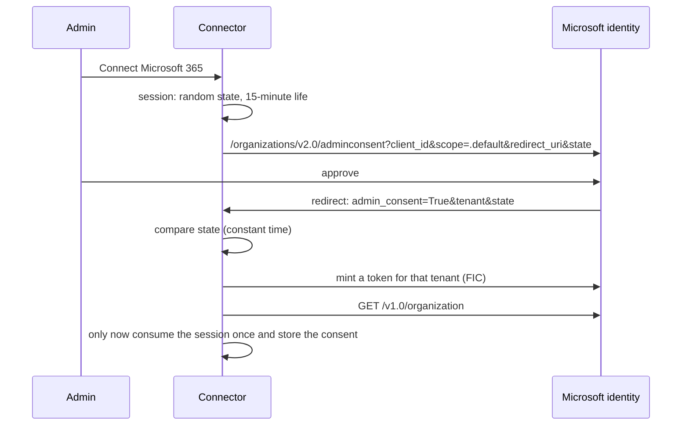

# Microsoft 365 auth: admin consent + federated identity credential

## Problem

The usual Microsoft lane makes the customer do the work. A Global Admin spends 10–15 minutes per tenant: register
their own app, copy ids, create a secret and copy its value before it disappears, note its expiry, pick Application
rather than Delegated permissions, grant consent, create a second app for SharePoint, then fill in a form per user.
Secrets must be rotated by hand, a leaked secret gives tenant-wide read, and every step is a support ticket.
**Never ship that lane.**

## Use when / Do not use when

- **Use when** you run the connector as a service for one or many Microsoft 365 tenants and can run it on a
  workload that has its own OIDC identity (Google Cloud, AWS, Kubernetes).
- **Do not use when** the connector runs on a laptop with no workload identity. Use the user connection below.

## Environment

The pattern does not say what language it is written in: not proven. It runs in the cloud, on a workload with its
own OIDC identity; it is proven on Google Cloud (the token comes from the metadata server on Cloud Run), and the AWS
and Kubernetes trusts are not proven. It needs a multi-tenant Microsoft Entra app whose only credential is a
federated identity credential, publisher verification (a Microsoft AI Cloud Partner Program account and a verified
domain), and Microsoft Graph. A laptop has no workload identity, so the pattern points it at the user connection,
which is proven in tests only; running it on one machine is not proven.

## Solution

**We own one multi-tenant Entra app** with Application permissions. **Its only credential is a federated identity
credential (FIC):** no secret and no certificate. The FIC trusts our cloud workload's own token, so there is nothing
to leak or rotate.

| Where the connector runs | FIC trusts |
|---|---|
| Google Cloud | issuer `https://accounts.google.com`, subject = the service account's **numeric unique id**, audience `api://AzureADTokenExchange` |
| AWS | outbound identity federation |
| Kubernetes | the cluster's OIDC issuer |

**Set up once:** the app; its FIC; **publisher verification** (free, needs a Microsoft AI Cloud Partner Program
account and a verified domain; without it, risk-based step-up consent blocks unverified multi-tenant apps in many
tenants, so do it before any customer pilot); **one redirect URI per deployment** (no wildcards; Web platform type).

**The customer admin connects** (service connection):

**We do not trust the returned `tenant` until a token minted for it has read `/organization`.** Microsoft warns
against trusting the returned tenant for authorization.

**At runtime, per customer tenant:**

1. Get the workload's own OIDC token with audience `api://AzureADTokenExchange` (on Cloud Run, from the metadata
   server).
2. POST it as `client_assertion` in a client-credentials request to
   `https://login.microsoftonline.com/{customerTenant}/oauth2/v2.0/token` with
   `scope=https://graph.microsoft.com/.default`.
3. Cache the Graph token per customer tenant, with a margin before it expires.

**Stored:** the consent record (our tenant, customer tenant, status, time). No secrets at all.
**Disconnect:** mark the consent revoked so every listing refuses, and tell the admin to remove the enterprise app.

**Permissions (Application):**

| Source | Permission |
|---|---|
| OneDrive, Teams channel files | `Files.Read.All` |
| SharePoint (**default**) | `Sites.Selected`, plus a grant per site |
| SharePoint (opt-in broad mode) | `Sites.Read.All` |
| Outlook mail | `Mail.Read` |
| Calendar | `Calendars.Read` |
| User list | `User.Read.All` |

**SharePoint is least privilege by default.** With `Sites.Selected`, the app sees no site until each is granted, and
granting needs `Sites.FullControl.All`, which our app must never hold. So the admin grants each site through a
guided panel: pick the site, copy the prepared grant call, run it in Graph Explorer, confirm. Every other source
stays one click. Broad mode (`Sites.Read.All`) is an opt-in per deployment, turned on only when the customer asks.

**User connection (delegated):** the admin has approved the app once; each user signs in with the PKCE
authorization-code flow on a confidential **Web** client (refresh tokens last about 90 days of inactivity, against
24 hours for an SPA client); we verify the id_token (issuer, tenant, nonce) and store the refresh token sealed with a
per-tenant key, bound by additional authenticated data to (our tenant, user, customer tenant). Expect admin consent
anyway: the file, mail and calendar scopes need it in practically every business tenant. Delegated scopes:
`Files.Read.All`, `Sites.Read.All`, `Mail.Read`, `Calendars.Read`, `Chat.Read`, `User.Read`, `offline_access`.

## Ports

| Port | Operation | Notes |
|---|---|---|
| Connection (provided) | `beginConsent(tenantHint?)` → redirect URL | creates the single-use session |
| Connection | `completeConsent(callback)` → consent | state check, token mint, `/organization` proof, then store |
| Connection | `token(customerTenant)` → Graph token | FIC exchange, cached |
| Connection | `disconnect(customerTenant)` | marks revoked |
| WorkloadIdentity (required) | `oidcToken(audience)` | the cloud's own token |
| ConsentStore (required) | `put/get/revoke` | no secret fields exist in it |

## Rules

1. The app has **no client secret and no certificate.** A secret found on the app is a defect.
2. **State is compared in constant time and consumed once,** after the tenant is proven, never before.
3. **The returned tenant is proven** with a token minted for it and a `/organization` read before anything is stored.
4. **FIC issuer, subject and audience match exactly.** On Google Cloud the subject is the service account's numeric
   unique id, not its email.
5. **The app never holds `Sites.FullControl.All`.**
6. **Revoked means every listing refuses,** not just new ones.

## Conformance

1. **Given** a callback whose `state` does not match, **then** nothing is stored and the session is not consumed.
2. **Given** a callback with a valid state but a tenant the FIC token cannot read `/organization` for, **then**
   nothing is stored.
3. **Given** a stored consent, **then** the store holds no field that is a secret, key or certificate.
4. **Given** two calls for the same tenant within the token's life, **then** one token exchange happens.
5. **Given** a revoked consent, **then** `token()` refuses and a running listing stops.
6. **Given** each error below, **then** it is reported with its meaning, not as "auth failed".

| Error | Means |
|---|---|
| `AADSTS700211` / `700212` | No matching FIC: the subject is wrong (fails silently until the exchange) |
| `700213` / `700024` | Subject or audience mismatch |
| `65001` | Not consented |
| `50011` | Redirect URI mismatch |
| `53003` | Conditional Access block; the credentials are valid |

## Swap points

- **The cloud** the workload runs on: only the FIC's issuer and subject change.
- **The consent and key stores.**
- Must not change: no stored secret, the tenant proof before storing, `Sites.Selected` by default.

## Sources

- Workload identity federation: https://learn.microsoft.com/en-us/entra/workload-id/workload-identity-federation
- FIC limits (20 per app; exact match): https://learn.microsoft.com/en-us/entra/workload-id/workload-identity-federation-considerations
- Publisher verification: https://learn.microsoft.com/en-us/entra/identity-platform/publisher-verification-overview
- Admin consent endpoint: https://learn.microsoft.com/en-us/entra/identity-platform/v2-admin-consent
- Client-credentials flow: https://learn.microsoft.com/en-us/entra/identity-platform/v2-oauth2-client-creds-grant-flow
- `Sites.Selected`: https://learn.microsoft.com/en-us/graph/permissions-selected-overview

## Known gaps

- **Proven** on Google Cloud against our own tenant; a customer tenant has not been run end to end.
- The user connection is proven in tests only.
- Teams message permissions (`ChannelMessage.Read.All`, `Chat.Read.All`) are protected APIs; whether a separate
  approval form is still needed is unverified.
