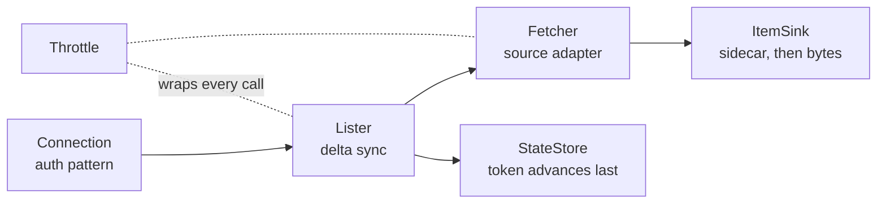

# Connector

## Problem

Connectors look simple and are not. Getting one provider's mail and calendar indexed took about ten days of trial
and error and one silent bug that lasted weeks. Most of that pain sat at the seams: a stage that dropped metadata,
a delta token that moved past a failed item, a customer admin pasting secrets into a form. This pattern fixes the
seams and leaves each source's API details to a source adapter.

## Use when / Do not use when

- **Use when** you pull files, mail, events or messages from a SaaS tenant (Microsoft 365, Google Workspace or
  similar) on a schedule and hand them to something that extracts and indexes them.
- **Do not use when** you need a live query against a public source. That is a source server answering an agent
  directly, not a sync.

## Environment

The pattern does not say what language the proven Microsoft part is written in: not proven. The same job handler
runs as a scheduled worker, a Kubernetes CronJob or a cloud job, so it runs locally or in the cloud. It names no
cloud service of its own: the sink, state store and key store are any store, and each auth pattern and source
adapter names the provider services it needs. Running it needs one test tenant seeded with mail, events with
attachments, recurring meetings, a Teams channel, non-ASCII subjects and large files, run on every change.

## Solution

A connector does four things, and nothing else:

1. **Authenticates** to a source on behalf of a tenant (an auth pattern).
2. **Lists** what changed since last time, with the provider's delta or change token (`connector-delta-sync`).
3. **Fetches** bytes by streaming them. A native cloud document is exported first.
4. **Writes items** to the sink: the sidecar first, then the bytes.

**A connector never:**

- extracts, parses, normalizes or indexes content;
- decides what an item is from which fields are present;
- sends bytes through a queue (it streams them straight to storage);
- holds a customer credential in plain text, or lets a third party hold one.

**Two connection models,** both supported by every source:

| | Service connection (org-wide) | User connection (one by one) |
|---|---|---|
| Who acts | The connector, as an app | Each person, with their own OAuth token |
| Setup | An admin approves once | The admin approves the app once, then each user signs in |
| Reads | Everything in scope across the org | Only what that user can see |
| Stores | **No secrets**: a consent record only | Each user's refresh token, envelope-encrypted per tenant |

The admin always takes the first step. The same item can arrive by both models; dedupe on the provider's
immutable id within the tenant.

## Ports

| Port | Operation | In | Out | Errors |
|---|---|---|---|---|
| Connection (provided) | `connect(tenant, model)` | tenant, `service` or `user` | consent record, proven by a test call before it is saved | `not_consented`, `blocked_by_policy` |
| Connection | `token(tenant, user?)` | tenant, optional user | access token, cached until shortly before it expires | `revoked`, `not_consented` |
| Connection | `disconnect(tenant, user?)` | | consent marked revoked or user token deleted | |
| SyncJob (provided) | `run(tenant, source, resource)` | one key | counts: listed, written, skipped, failed; resumable | `contract_error` (loud), `throttled` |
| ItemSink (required) | `put(item)` | sidecar (typed metadata, passed whole), then a byte stream | item id | |
| StateStore (required) | `get(key)` / `advance(key, token)` | key = (tenant, source, user or drive, resource) | | |
| KeyStore (required) | `seal(tenant, aad, bytes)` / `open(...)` | per-tenant key, additional authenticated data | | |
| FailureLog (required) | `alert(kind, detail)` | | | |

**Item:** `id` (stable: provider immutable id + tenant + source; a child's id derives from its parent's id and its
position), `kind` (`file`, `email`, `calendar_event`, `chat_message`, `cloud_doc_export`), `parent_id`,
`vendor_hash` (the provider's content token), the sidecar and the bytes. The sink owns the item contract; the
connector maps the provider's shapes onto it, so the sink has no provider-specific branch.

## Rules

1. **Decide an item's kind from `kind`,** never from which fields are present.
2. **Bytes never travel through a queue.** Stream them from the provider's content endpoint to storage.
3. **Write the sidecar first, then the bytes.** Keep all typed metadata in the sidecar; storage headers must be
   ASCII (Unicode subjects broke downloads when metadata rode in headers).
4. **Never strip unknown keys between stages.** One typed sidecar, passed through whole. (A stage four hops
   downstream kept an allow-list of about 15 keys, and mail was indexed with no sender, subject or thread.)
5. **No provider field or parameter goes in without proof** from the provider's docs or a live response. A
   contract-shaped 4xx (a 400 on a field, parameter or URL shape) is an alert, never a routine warning.
6. **Item ids are stable across rescans.** Random child ids duplicated archive children on every rescan.
7. **One job per (tenant, source, resource), resumable.** The same job handler runs as a scheduled worker, a
   Kubernetes CronJob or a cloud job.
8. **Mail, event and message items are content containers, not archives.**
9. **Every new item kind reaches the sink's intake, index mapping and preview in the same change,** verified live.
10. **Counters show one scan, never a sum across scans.**
11. **No customer credential is stored where a model needs none.** The service connection stores a consent record
    only.

## Conformance

1. **Given** a provider page whose second item's child fails to write, **when** the job runs, **then** the state
   token is unchanged and the next run lists the item again.
2. **Given** a rescan with zero changes, **when** the job runs, **then** it completes, reports 0 written, and
   re-extracts nothing.
3. **Given** an item with a non-ASCII subject, **when** it is written, **then** the subject arrives intact in the
   sidecar and nothing non-ASCII is sent as a storage header.
4. **Given** a sidecar key the connector does not know, **when** the item passes through, **then** the key reaches
   the sink unchanged.
5. **Given** a provider 400 on a `$select` field, **when** the call fails, **then** a `contract_error` alert is
   raised and the job stops that resource rather than skipping the item quietly.
6. **Given** the same item reached by the service and a user connection, **when** both write, **then** the sink
   holds one item.
7. **Given** a revoked service consent, **when** any listing starts, **then** it refuses.
8. **Given** an archive or mail item with children, **when** it is rescanned, **then** the children keep their ids.
9. **Given** an item listed with an unchanged content token but a new name or path, **when** it is processed,
   **then** it is a metadata-only update and its bytes are not fetched again.

## Swap points

- **The source adapter** (`connector-m365-graph`, `connector-google-workspace`, or a new one). It must keep the
  Item mapping and the rules above.
- **The auth pattern.** It must keep "no secret stored for the service connection".
- **The sink, state store and key store.** Any store works; the order sidecar-then-bytes and "token advances last"
  must not change.
- **Where the job runs** (scheduled worker, CronJob, cloud job). The handler is the same.

## Sources

The provider claims live in the parts that make them; each part lists its own first-party sources.

## Known gaps

- Permissions and sharing metadata, version history and retention labels are not carried yet.
- Microsoft's Outlook item attachments (an attached email or event) and reference attachments (cloud links) are not
  handled.
- Google is designed, not run.
- **Way of working:** keep one test tenant with seeded mail, events with attachments, recurring meetings, a Teams
  channel, non-ASCII subjects and large files, and run it on every change. Before fixing anything, prove the
  assumption against real data, and audit the whole path (list → fetch → sidecar → intake → extract → index →
  preview) instead of clicking until the next thing breaks.
