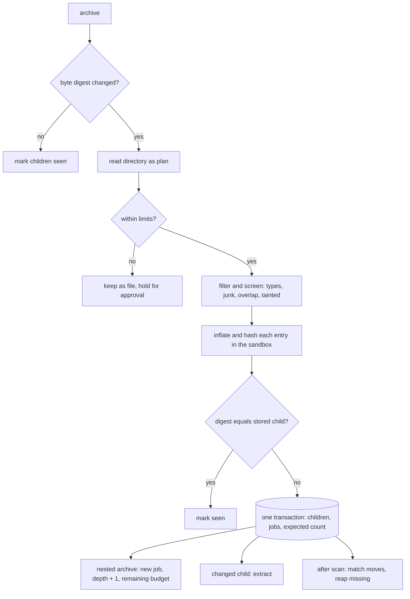

# Archives and children

## Problem

A zip, an email with attachments, or a Word file with an embedded spreadsheet holds documents a reviewer must find, but a hit on one of them means little without the container it came from. Children given fresh ids on every pass multiply on each rescan. A small archive can expand to fill a disk, and its own directory can lie about sizes and checksums. Extracting a whole archive again because one entry changed wastes hours. A scan that counts its work before the children exist can finish early with half of them missing.

## Use when / Do not use when

Use when collections hold zip or tar archives, email with attachments, or documents with embedded files. Do not use when every item is a single, flat file.

## Environment

Expansion runs as its own job per archive, and every unpack runs in the extractor's sandboxed child process (index-extract), never in the worker itself. It needs the blob store for originals, the transactional database for items and the job queue, and scratch space of at least twice the archive's declared total.

## Solution

A container is any item that holds other items: an archive (zip, tar, tar.gz, tgz, gz), an email and its attachments, a calendar invite and its attachments, or a document with embedded files. Every child becomes an item of its own, extracted and indexed like any file, and linked to its container.

**Who makes children.** Extraction makes the children of an email and of a document with embedded files, from the one parse of its MIME or package (index-markdown rule 1); a message nested inside a message is a child that keeps its parent's context. This expander makes the children of archives. Each kind of container has exactly one owner, so no child is made twice.

**Identity.** A child's id is a SHA-256 hash of its parent's id and its path inside the parent, normalized to NFC, so a child keeps one id across every rescan and a re-unpack overwrites rather than duplicates. An archive entry's path is its stored name. An email's or document's children have no stable path, because a part's position shifts when another is inserted: their key is the child's byte digest with its file name, plus an occurrence number among children sharing both, so inserting or reordering attachments moves no other child's id, and two attachments both named `image001.png` stay two children. The MIME or package part path is recorded, not used as identity. Each child records its immediate parent, its top container, its depth and its inner path. Folders inside an archive are kept only as paths; a directory entry is never an item. A nested archive is a child marked as a container itself.

**The order, for one archive:**

1. **Check the container.** Compare its byte digest (SHA-256 and BLAKE3, index-content) with the stored one. An unchanged archive is skipped whole: its children are marked seen, never unpacked.
2. **Read the directory as a plan, not as proof.** A zip's central directory lists names, sizes and CRC-32 values, all written by whoever made the file. Tar, tar.gz and gz have no directory to read, and gzip's size field holds the size modulo 2^32. Use the directory to plan and to check limits early; never to decide that an entry is unchanged.
3. **Check the limits.** Every limit is a tenant setting; the defaults are below. Over any limit, nothing is unpacked: the archive is kept as an ordinary file with the reason and held for approval, as index-intake holds an oversize file. Approval raises the limits for that one archive.
4. **Filter and screen the entries.** Skip entries the collection's file types exclude, and skip junk: `__MACOSX/`, `.DS_Store`, and AppleDouble `._*` files confirmed by their magic bytes `00 05 16 07`. Refuse the whole archive when entries overlap one another or the central directory disagrees with an entry's local header. Refuse, with its reason, each tainted entry: a path that climbs out (`..`, an absolute path, a drive letter), a symbolic or hard link, a device or pipe, an exact duplicate name after NFC, an encrypted entry, and a compression method the reader does not support.
5. **Inflate and hash every remaining entry, in the sandbox.** Stream each entry, counting bytes as they arrive and cutting it at its declared size, and take its SHA-256 and BLAKE3. An entry that inflates past its declared size, or whose CRC-32 does not match, is refused as tainted. For tar and gz, the same counters run while streaming to scratch, and a limit hit aborts and discards the partial output. An entry whose digest equals its stored child's is unchanged: it is marked seen, and neither stored nor extracted again. Inflating is cheap; extraction is the cost this saves.
6. **Commit the children and their work together.** Write the changed child items, their extraction jobs and the scan's raised expected count in one transaction, so a scan can never count itself done before its children exist. A nested archive goes back on the queue as its own job, at depth + 1, carrying what is left of its top container's budgets.
7. **Match moves, then reap what is gone.** In one scan, a gone child and a new child with equal byte digest are a move, when exactly one of each shares that digest: the new child takes the old one's tags, comment threads and content, then the old one is reaped. When several gone or new children share one digest, none are paired, because a guessed pairing moves a comment onto the wrong copy. A child missing from the re-read archive is removed: its record first, on a condition that it still holds the same digest, then its search documents and stored bytes. An unfinished removal stays on the durable list of unfinished work.

**Default limits.**

| Limit | Default |
|---|---|
| Total uncompressed, per top container, summed across every nesting level | 50 GiB |
| Any one entry | 10 GiB |
| Entries per container; descendants per top container | 100,000; 1,000,000 |
| Expansion ratio, whole container, checked once its total passes 1 GiB | 100:1 |
| Expansion ratio, one entry: above 100 MiB; at any size | 200:1; 1,032:1 |
| Depth | 5 |
| Free scratch space | 2x the declared total, with 10% of the disk left free |
| Unpack deadline, in place of index-extract's parser default | 30 seconds plus 1 second per 50 MiB declared |

A nested archive draws on its top container's remaining total and descendant budgets, because a budget reset at each level multiplies by the depth. DEFLATE cannot compress past about 1,032:1, so an entry that claims more has a false size. The container ratio waits for 1 GiB because small logs and spreadsheets legitimately compress that well.

A container that will not open, because it is corrupt or protected by a password, is kept as an ordinary file with the reason, not reported as failed. A container still gets its own metadata indexed; an email's own text is its body. A child's failure shows on its container as a count of failed children; the container itself is not failed.

**Deleting.** Removing a container removes its children through the same reap. Erasing a container erases every child and every derivative of them (index-content).

**Showing them together.** A child's search result carries its parent chain. The results grid offers a flat view and a grouped view, where each child sits under its email, thread or archive and a container's row counts its matched children; the server shapes the grouped view as ordered rows, each with its depth (search-ui). Opening a child shows its inner path; opening a container lists its children. Access to a child is checked like any item (index-access).

## Ports

- ContainerExpander.expand(archive, limits, filters): children with id, parent, top container, depth, inner path and digests; entries skipped or refused with their reason; the limit hit, if any. Errors: unreadable archive (kept as a file), over a limit (kept as a file, held), overlapping entries (refused).
- Database commits the children, their jobs and the scan's expected count in one transaction.
- WorkQueue (index-run-control) holds one job per nested archive and per changed child, each with a renewable lease.

## Rules

1. **Give a child an id from its parent's id and its NFC inner path, or, for email and embedded children, its digest, name and occurrence,** because ids made fresh on each pass multiply rows on every rescan, a part position shifts when an attachment is inserted, and two attachments with one file name are still two documents.
2. **Decide that an entry is unchanged only from its own inflated bytes' digest,** because a zip's sizes and CRC-32 are written by whoever made it, gzip carries only a CRC-32, and tar entries, MIME parts and embedded parts carry no content checksum.
3. **Check directory limits before unpacking, and enforce the same counters while streaming,** because a few kilobytes can expand to fill a disk, and stream formats have no directory to check first.
4. **Refuse overlapping entries and directory mismatches outright,** because overlapping entries reach ratios that per-entry checks miss.
5. **Refuse tainted entries (climbing paths, links, devices, exact duplicate names, encrypted entries, unsupported methods) and record each with its reason,** because an archive can write outside its folder, hide one file behind another, or ask the reader for a codec it cannot bound.
6. **Unpack only in the extractor's sandbox, with a deadline scaled to the declared size, and treat every child failure as that file's failure,** because a crafted archive can exhaust or take over the process that opens it, and a fixed short deadline cannot unpack a large legitimate archive.
7. **Commit the children, their jobs and the raised expected count in one transaction,** because a count raised after the children are written can fail and let the scan finish early.
8. **Run each nested archive as its own job with a renewable lease and its top container's remaining budget, and stop at the depth limit,** because recursion in place runs past every timeout, and a budget reset per level multiplies it.
9. **Keep an unreadable or over-limit container as an ordinary file with its reason, and hold an over-limit one for approval,** because a reviewer must still see that it exists, and a silent skip reads as a complete collection.
10. **Carry tags and comments across a move only when the pairing is unique,** because a rename otherwise loses a reviewer's work, and a guessed pairing attaches it to the wrong copy.
11. **Reap missing children after the scan, record first and conditionally,** because a child removed while a scan still runs may be about to reappear.
12. **Remove and erase children with their container,** because a child left behind keeps text its owner removed.

## Conformance

1. Given a zip rescanned with no change, nothing is unpacked and every child keeps its id.
2. Given a zip with one changed entry, every entry is inflated and hashed, only the changed one is stored and extracted again, and the rest keep their ids.
3. Given a zip whose central directory lists an unchanged CRC-32 for an entry whose bytes changed, the entry is found changed by its digest.
4. Given an entry renamed inside a zip, the new child carries the old one's tags and comments and the old one is reaped; given two identical copies renamed at once, neither is paired and both are removed and added.
5. Given a file name stored once in NFC and once in NFD, both give one child id; given an email with two different attachments named `image001.png`, both become children; given an attachment inserted before them on a new version, neither one's id changes.
6. Given a zip bomb, an entry count over the limit, or a ratio over the limit, nothing is unpacked and the archive is kept as a file, held for approval with the reason; given overlapping entries, the whole archive is refused.
7. Given a gz whose stream passes the total limit, unpacking stops at the limit and the partial output is discarded.
8. Given an entry that inflates past its declared size, the read stops at that size and the entry is refused.
9. Given an archive six levels deep, levels one to five are expanded and the sixth is kept as a file; given nested archives whose sum passes the total, the level that passes it is held.
10. Given a password-protected zip, it is searchable by name, marked not unpacked with the reason, and not counted as failed.
11. Given a crash after children are written, either the children, their jobs and the raised count all exist, or none do.
12. Given a search hit in an attachment, the result shows its email; the grouped view puts it under the email, and the email's row counts the matching child.
13. Given a container erased, none of its children or their derivatives can be found or opened.

## Swap points

Replace the archive readers, the limits and their defaults, while keeping stable child ids, digests over inflated bytes as the only change proof, one owner per container kind, limits checked before and during unpacking, one transaction for children and their work, and children removed with their container.

## Sources

- [ZIP file format, central directory and local headers](https://pkware.cachefly.net/webdocs/casestudies/APPNOTE.TXT).
- [A better zip bomb: overlapping entries and DEFLATE's 1,032:1 limit](https://www.bamsoftware.com/hacks/zipbomb/); [paper](https://www.usenix.org/conference/woot19/presentation/fifield).
- [GZIP format: size field modulo 2^32](https://www.rfc-editor.org/rfc/rfc1952).
- [Unicode normalization](https://unicode.org/reports/tr15/).
- [BLAKE3](https://github.com/BLAKE3-team/BLAKE3); [SHA-256, FIPS 180-4](https://csrc.nist.gov/pubs/fips/180-4/upd1/final).

## Known gaps

Designed, not run: change by inflated digest, the default limits and inherited budgets, move matching, the scaled unpack deadline, the hold for approval, and the one transaction for children and the expected count. Proven: stable child ids, skipping an unchanged container, entry screening, the sandbox's process limits and reaping.
