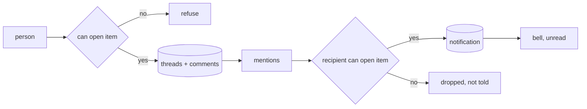

# Comments

## Problem

Reviewers discuss a document beside it. If the access check rests on an unguessable thread id, anyone holding the id reads the thread. If anyone in the tenant can be mentioned, a notification carries a file's name and path to a person who cannot open it. A quote kept with a comment survives the document's erasure unless it is purged with it. And a comment pinned to text points at the wrong words once the document changes.

## Use when / Do not use when

Use when people discuss items during review. Do not use for chat that is not about an item.

## Environment

A record store holds threads, comments and notifications. Every call runs as a signed-in person whose access to the item index-access resolves.

## Solution

**Model.**

- A **thread** belongs to one item: id, item, title, state (open or resolved), author, times, and an optional anchor.
- A **comment** belongs to a thread: author, time, edited time, a deleted flag, and a body of segments, each either text or a mention of a person by id, up to 10,000 characters.
- A **notification** belongs to one recipient: kind, thread, item, read flag, time.

**Access.** Every read and write resolves the item through index-access first. Listing threads, reading a thread, posting, editing, resolving and reopening all require that the person can open the item. Editing or deleting a comment is limited to its author; resolve and reopen to anyone who can post. A deleted comment's body is removed and the thread shows that a comment was deleted.

**Threads.** A thread opens with a title and a first comment. Resolve closes it to new comments; reopen opens it again. Threads on an item are listed newest activity first, open before resolved.

**Anchors, optional.** A thread may anchor to a passage of the original text, never of a translation: its zone, the quote (up to 1,000 characters), 32 characters before and after, and its offsets in the stored text of that content version, counted in Unicode scalar values. When the content changes, the anchor is placed again by trying, in order: the same position with the same quote; the quote where it occurs once; the quote with its context; a bounded fuzzy match nearest the old position. The result is placed, moved or orphaned, and the thread shows which. An orphaned anchor keeps its quote and the thread, and is tried again on each new content version.

**Mentions.** The mention picker offers only people who can open the item. On post, the server checks each mentioned person again and drops any who cannot, so the post succeeds and nobody without access is told. The author is never notified of their own post.

**Notifications.** Each mention writes one notification for its recipient. The list and the unread count include only notifications whose item the recipient can still open. A bell shows the unread count; opening a notification opens the item and thread, and marks it read. Delivery is push where the platform offers it, otherwise polling that backs off (30 seconds, doubling to 5 minutes, with jitter) and resets on activity. A notification is checked against the item again when opened, so revoked access shows nothing.

**Erase and quarantine.** Erasing or quarantining an item removes or hides its threads, comments, anchors with their quotes, and notifications with it (index-content).

## Ports

- CommentStore.threads(item), thread(id), open(item, title, body, anchor?), post(thread, body), edit(comment, body), delete(comment), resolve(thread), reopen(thread). Errors: item not visible, thread resolved, not the author, body over the limit.
- CommentStore.mentionable(item, prefix): people who can open the item.
- Notifications.list(unread?), count(), markRead(ids).
- AnchorPlacer.place(anchor, content version): placed, moved with new offsets, or orphaned (platform-data-model).

## Rules

1. **Check item access on every comment read and write,** because a thread id is not a permission and can be shared or guessed.
2. **Offer and deliver mentions only to people who can open the item, checked on the server,** because a notification carries the item's name and path to whoever receives it.
3. **Check access again when a notification is opened, and leave out of the list and count any whose item is no longer visible,** because access can be revoked after it was sent, and a count or a list title names an item too.
4. **Refuse new comments on a resolved thread, and allow reopen,** because a closed thread that silently takes comments hides them from the people who closed it.
5. **Store mentions as person ids, not names,** because names change and two people can share one.
6. **Place anchors by position, quote, context and bounded fuzzy match, in that order, and show placed, moved or orphaned,** because offsets alone point at the wrong words after the content changes, and a quote that occurs twice must not jump to the wrong one.
7. **Purge threads, quotes and notifications when their item is erased,** because a quoted passage is a copy of the erased text.
8. **Back off polling and reset it on activity,** because a fixed short poll from every open screen loads the service for nothing.
9. **Cap the body length on the server and let only the author delete a comment,** because an unbounded body is a storage attack, and a deleted comment must not survive as quoted text.

## Conformance

1. Given a person without access to an item and a valid thread id, reading, posting and resolving are refused.
2. Given a mention of a person without access to the item, the post succeeds, no notification is written, and the picker never offered them.
3. Given access revoked after a notification, opening it shows nothing of the item.
4. Given a resolved thread, a new comment is refused; after reopen it is accepted.
5. Given an anchored thread and a new content version that moves the passage, the anchor is reported moved with new offsets; given one that deletes it, orphaned, with its quote kept and the thread remaining; given a new version where the quote occurs twice, the context picks the right one.
6. Given an erased item, its threads, comments, quotes and notifications are gone.
7. Given an idle screen, polling slows to 5 minutes; given a new post, it resets.
8. Given a notification for an item the recipient can no longer open, it is absent from the list and the count.
9. Given a body of 10,001 characters sent straight to the service, it is refused; given a comment deleted by its author, its body is gone and the thread shows the deletion.

## Swap points

Replace the store, the notification transport and the anchor placer, while keeping item access on every call, mentions limited to people with access, anchor states, and purge with the item.

## Sources

- [Text quote and position selectors](https://www.w3.org/TR/annotation-model/#text-quote-selector).

## Known gaps

Proven: threads with titles and resolve, text and mention segments, mention notifications with an unread bell and backoff polling, item access on reads and writes. Designed, not run: reopen, delete, access-checked mentions and notification lists, text anchors and their placement, and purge with the item.
