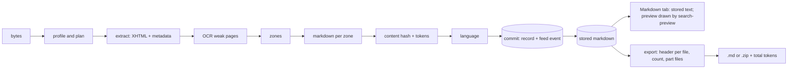

# Markdown

## Problem

People want to take a set of documents into a chat session with a model, as clean text. Converting each file straight from its binary repeats the parsing, loses footnotes and headers, and gives different text than search shows. A merged export with no token count fails only once it is uploaded, because the session's context window is full. And when the file's name, path or extraction time are written into the stored markdown, two identical documents hash differently and are stored twice.

## Use when / Do not use when

Use when people read documents as markdown, or export a selection of them for a model session. Do not use when only search is needed and nobody reads or exports text.

## Environment

Runs in the extraction workers and as a separate export job. It needs the extractor's XHTML and zones, a blob store for the stored markdown and the exports, a tokenizer for each model offered, and a zip writer.

## Solution

Markdown is made from the extracted content, never from the binary, and the search text, the markdown and the record all come from that one extraction.

The order, for one file:

1. **Profile.** Read the bytes once, detect the true type from the content (index-file-type), count pages or sheets, and pick the file's step plan.
2. **Extract.** Each format family has one extractor, and each returns the same two things: structured XHTML and metadata.
   - Most formats: Tika, in one call to its recursive metadata endpoint with its default XML handler (`/rmeta` or `/rmeta/xml`; `/rmeta/html` returns HTML instead), which returns the XHTML and the metadata of the file and of each embedded document together. It returns no embedded bytes: the children's own bytes come from Tika's `/unpack`, a second parse that returns one level of children at a time, and each child becomes its own item (index-archives).
   - Email: a MIME parser, such as [mailparser](https://github.com/nodemailer/mailparser) for `.eml`, reads the message once and returns its header fields, its body as HTML, and its attachments, each with its MIME part path; `.msg` and mail stores go through Tika. The body is normalized into the same XHTML form, so its quoted replies are a separate part. The attachments become children of the email (index-archives), and a message nested inside it keeps its parent's context.
   - Spreadsheets: a sheet parser returns each sheet as an XHTML table, with formatted and raw values.
3. **OCR, for scanned pages.** Pages whose digital text is weak are OCR'd one by one and merged into the XHTML in page order; pages with good digital text keep it (index-extract-ocr).
4. **Zones.** Find body, header, footer, footnotes, comments, slides and sheets in the XHTML with an HTML parser (index-extract-tika), and chunk them for search.
5. **Markdown.** Convert each zone's XHTML with Turndown: ATX `#` headings, `-` bullets, fenced code. Tables use a custom rule, not the GFM plugin's, because that plugin keeps a table without a header row as raw HTML and extracted tables rarely have one: every table becomes a pipe table, its first row the header, newlines inside a cell collapsed to spaces, and `|` escaped. Each zone goes under its own `## BODY`, `## HEADER` and so on, and the document's own headings move down to level 3 and below, so only zones are level-2 boundaries. Footnote references become `[^N]`, with their definitions read from the source XHTML and appended at the end. An email or calendar event starts its `## BODY` with its own fields as bold labels (from, to, cc, subject, date; or subject, organizer, when, location, attendees), then `---`, then the body, because those fields are the message's content. Its attachments are listed by name under `## ATTACHMENTS`.
6. **Hash and count.** Compute the content hash, SHA-256 and BLAKE3, over the normalized markdown (index-content), and count its tokens with tiktoken's `o200k_base` encoding (the one gpt-4o uses).
7. **Language.** Detect the languages of the markdown and decide whether it needs translating (index-translation).
8. **Commit.** Store the markdown gzipped under the item version, and commit the content record (hashes, count, languages, each step's outcome and the metadata) with its feed event in one conditional write, made only if this worker still holds the job and no stop is in force. The search engines index from that feed (index-content), and each attachment, embedded file or archive child becomes its own job (index-archives).

If extraction fails, no markdown, content hash or token count is stored. The item is still committed with its file metadata and indexed by name, path and dates, marked failed with the step and the reason, so a person can find it and retry it. An archive has no markdown of its own; its children do. An image gets markdown only from its OCR text.

**Metadata stays beside the markdown, not in it.** The file's name, path, dates, size and source come with the intake job. Tika's metadata (title, author, created and modified dates, page count, application, content type) is kept as returned. An email's sender, recipients and dates, and an event's fields, are stored in their original casing for display. All of these go on the item's record, the system of record for metadata, and join the markdown when it is shown or exported. The stored markdown has no front matter, so identical content gives identical bytes and one content hash.

**Markdown tab.** Each file's record carries a markdown status, its error, and a flag that asks for the markdown to be made again. The Markdown tab shows the stored markdown as plain text, exactly as stored, loaded only when the tab is first opened and only when the status says it was made; otherwise it says "No markdown available for this file." A load failure is shown in words. One button copies the whole markdown. For a translated item it offers both texts (index-translation). How the preview pane draws markdown and every other format safely is search-preview.

**Export.** A person picks files, by list, by tag or by query, then a model; choosing the model fills in its context window less a reserve for the person's own prompt (default 10%) as the token limit, which the person can change. For a translated file the person chooses the original, the English translation, or both; translated text is labeled with its model. A selection by tag or query is resolved under the person's access when the job starts and then frozen. A large selection arrives in batches, and the job starts once every batch has arrived. The job reads each chosen file's stored text in order and writes a short header (name, path, dates) before each one. It counts each file, header included, with the chosen model's tokenizer, and fills numbered part files (`<name>_001.md`, `<name>_002.md` and so on). A new part starts when the next file would pass the limit, and a file is never split. One part is delivered as a single `.md` file, and more than one as a zip. The export records its status, part count and total tokens, so the person sees whether it fits before uploading it. A list of exports shows each one's status and total tokens, and offers the download once it is complete or finished with a warning. A finished export expires (default 7 days), and erasing an item it holds makes it undownloadable (index-content).

## Ports

- MarkdownBuilder.build(zones, footnotes): markdown text and zone map. Errors: no zone holds text.
- MarkdownExport.create(selection, model, token limit): export id; batches are added with their count. It reports status, parts, total tokens, and a warning naming each part over the limit. The download link is short-lived and checked by index-access.
- MarkdownView.show(item, language): the exact stored text of the original or of its translation. Refused when the markdown was not made, with the status and error; access is checked on every request.
- Tokenizer.count(model, text): the token count for that model.

## Rules

1. **Make markdown from the extracted zones, never from the binary,** because a second parse of the bytes drops zones and gives text that differs from what search shows. Email is parsed once by its MIME parser, and its markdown, search text and attachments all come from that one parse.
2. **Run the steps in order (profile, extract, OCR, zones, markdown, hash and count, language, commit),** because each step reads the one before. **After a failed extraction, skip the content steps but still commit and index the item's metadata, marked failed,** because a file that disappears from search cannot be found to retry.
3. **Pin the converter, its options and its table rule, and record their version among the processing versions,** because a converter or option change rewrites every section and its hashes. **Emit every table as a pipe table with its first row as the header,** because a table kept as raw HTML is neither readable as markdown nor searchable as cells. Escape a literal `|` inside a cell and collapse its newlines, because either one splits the cell.
4. **Keep metadata out of the stored markdown,** because a name, path or extraction time in the text makes identical content hash differently. Add a per-file header only when exporting.
5. **Read footnote definitions from the source XHTML, not from the converter's output,** because Turndown escapes square brackets.
6. **Count stored tokens once, when the markdown is made,** with tiktoken's `o200k_base` encoding (the one gpt-4o uses), over the whole markdown, and store the count on the item. Use it only to show size, total a selection, and decide whether a document is sent to a model whole or read in parts, because other models' tokenizers differ, so the stored count is labeled an estimate for any other model.
7. **Count an export's final text, headers included, with the tokenizer of the model the person chose,** because a stored estimate can pass a limit that the real count fails. For an OpenAI model, use tiktoken's encoding for that model. For a model whose tokenizer is not public, use its provider's token-count endpoint only when the tenant has approved sending the text to that provider, because counting there sends the content out. Otherwise label every count an estimate on screen.
8. **Never split a file across parts, and warn by name about a file over the limit,** because a cut document reads as complete. A file larger than the limit gets a part to itself, and the export finishes with a warning listing those parts.
9. **Start an export only when all its batches have arrived,** because a job that starts early exports part of the selection without saying so.
10. **Check access on every file in the selection and on the download; refuse a list naming a file the person cannot read, and freeze a tag or query selection under access at job start,** because an export copies text out of the system, and naming a hidden file must answer as a missing one. Erased or quarantined content is never exported, and a finished export expires.
11. **Leave every preview rendering rule to search-preview,** because rules stated in several patterns drift apart.
12. **Show the Markdown tab exactly as stored, load it only when opened, and say when there is none,** because a person checking what will be exported must see the real text, and an empty pane reads as a broken one.

## Conformance

1. Given a document with headings, bullets, code, footnotes and a table with no header row and a pipe and a line break in one cell, the markdown has `## BODY` and `## FOOTNOTES` zones, document headings at level 3, `-` bullets, fenced code, `[^N]` references with definitions at the end, and a pipe table whose first row is the header, with the pipe escaped and the line break collapsed.
2. Given the same content under two names and paths, both store byte-identical markdown with equal hashes, and each record keeps its own name, path and dates.
3. Given a failed extraction, no markdown, content hash or count is stored; the item is found by its name, reads as failed with the step and reason, and can be retried.
4. Given a finished item, its stored count equals `o200k_base`'s count of its stored markdown, and its record's hash, count and metadata were written in one write.
5. Given three files that count 400,000, 500,000 and 300,000 tokens with their headers, and a 1,000,000-token limit, the export is a zip of two parts (900,000 and 300,000) and reports a total of 1,200,000.
6. Given one file that counts 1,200,000 tokens with its header, and a 1,000,000-token limit, the export is one `.md` file, finished with a warning that names it.
7. Given an export expecting three batches with two arrived, it has not started; the third batch starts it.
8. Given a list naming a file the person cannot read, the export refuses with the same answer as for a file that does not exist, naming nothing hidden; given a tag selection holding such a file, the export leaves it out and its set does not change after the job starts.
9. Given a translated file and the choice of both, the export holds the original and the English, the English labeled with its model.
10. Given a finished export and one of its items erased, the export can no longer be downloaded.
11. Given a file whose markdown was made, the Markdown tab shows the stored text byte for byte and copies it whole; given one whose markdown was not made, it says so and makes no request.
12. Given a person without access to the item, the Markdown tab refuses.

## Swap points

Replace the extractors, the converter, the renderer, the tokenizer, the zip writer and the store, while keeping markdown made from zones, metadata out of the stored text, whole files in parts, and counts made with the chosen model's tokenizer.

## Sources

- [Tika server endpoints](https://cwiki.apache.org/confluence/display/TIKA/TikaServer).
- [mailparser](https://github.com/nodemailer/mailparser), MIT.
- [Turndown](https://github.com/mixmark-io/turndown), MIT; [turndown-plugin-gfm](https://github.com/mixmark-io/turndown-plugin-gfm), whose table rule keeps header-less tables as HTML.
- [tiktoken](https://github.com/openai/tiktoken), MIT.
- [archiver](https://github.com/archiverjs/node-archiver), MIT, for the zip.

## Known gaps

Designed, not run: the single recursive metadata call, the custom table rule, moving document headings to level 3, the `## ATTACHMENTS` list, the per-file export header, the export's language choice and expiry, and counts for models without a public tokenizer.
