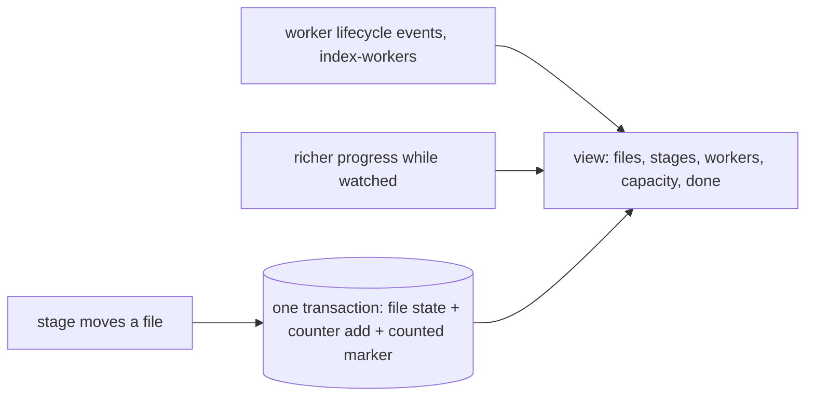

# Indexing progress

## Problem

An upload or a connection without progress is a black hole: a person cannot tell whether their files are waiting, being worked on, stuck or done. Counters bumped twice by a redelivered message read as more than done; counters that miss one write stall short of done forever. A list read with a limit before its filter silently drops rows on a large run. A view that blinks empty between files reads as a crash.

## Use when / Do not use when

- **Use when** people upload files or connect sources and wait for them to become searchable.
- **Do not use when** indexing is a batch nobody watches and only the end result matters.

## Environment

The transactional database that holds items and jobs (index-run-control), the work queue, and a screen that polls or subscribes. A view on this data is one example, such as a side panel opened from the source; this pattern sets what it holds, not its layout.

## Solution

**A run.** Each upload batch, connection sync or rescan is a run, with an id that sorts by time, so "the latest run" is the newest. A run holds a counter per stage and outcome, in UPPER_SNAKE states: `TOTAL`, `INGESTED`, `REJECTED`, `EXTRACTED`, `TRANSLATED`, `COMPLETED`, `FAILED`. Each stage adds to its counter in the same transaction that moves the file (index-intake), as an atomic add. `TOTAL` grows as archives and emails expand into children (index-archives), so the denominator is honest while expansion runs. A file counts toward `COMPLETED` or `FAILED` once per run: the transaction that counts it sets a counted-for-this-run marker on the file, conditional on the marker being absent, so a redelivered message cannot count it twice. The run is done when `COMPLETED + FAILED + REJECTED` reaches `TOTAL`, checked after every count, including a count skipped as a duplicate; it is finalized once. A counter write that fails is retried, then fails the job loudly for redelivery; it is never swallowed.

**A file in flight.** While a worker holds a file, the file records its stage, step number and count, step name, pages done and total, the worker's id, and a heartbeat time; finishing clears them. The finishing write is conditional on the worker still holding the current lease, so a replaced worker cannot finish a file another now owns. Heartbeats run whether or not anyone is watching (index-workers); richer progress (each step change, each quarter of the pages) is written only while someone is: an open view holds a watch lease (default 5 minutes) and renews it while open.

**Worker states**, from the recorded lifecycle events (index-workers) and the heartbeat's age: `QUEUED` (claimed, no heartbeat yet), `RUNNING` (heartbeat fresher than the threshold, default 45 seconds), `STALLED` (older), `REPLACING` (the watchdog released its lease, until another worker claims the file), `COMPLETED`, `FAILED`.

**Workers and capacity.** The view shows the workers assigned to this run, the workers in use in total against the total available, and which file each assigned worker is on, from the capacity ledger and the lifecycle records of index-workers, which owns the queue, scaling, the stuck watchdog and shutdown. A started worker appears, a finished file shows finished, an exited worker leaves.

**What a person sees.** Every file they added, its stage and progress; a row for each claimed file not yet reported, so a claim shows at once; a between-files state when workers are warm and idle, so the list never blinks empty; the stage counts and how many are searchable, failed and remaining; an estimate of time left, from rates measured on this run's finished files; and failures grouped by type, stage and reason, with an export (escaped as search-ui sets). A reconciliation check compares the counters with a count of file states and reports a drift in words.

**Reading it at scale.** Every view takes its stage counts from one shared derivation. Stage buckets are counted from an index on file state, never by reading every file row. A filtered read pages until it has the count asked for, because a limit applied before a filter returns fewer rows than exist. Fleet counts are no older than the poll interval. Long file lists are virtualized. Polling pauses while the view is hidden; pushing changes to the view (server-sent events or subscriptions) is an option to polling.

## Ports

- **ProgressRecorder:** adds stage counts with the file's move, marks a file counted once per run, records in-flight fields and heartbeats, and finalizes a done run once.
- **ProgressView.run(run, page)** → counters, stage counts, done, estimate, workers and capacity, and a page of files with their stage and progress; **failures(run, group by)** → grouped failures; **watch(run)** → a renewable watch lease.
- **Database** (required): the transaction that moves a file.
- **WorkerLifecycle** and **CapacityLedger** (required, index-workers): the recorded worker events and the reservations shown.

## Rules

1. **Add each stage's count in the transaction that moves the file,** because a counter written separately drifts from the files it counts.
2. **Count a file's outcome once per run, behind a conditional marker,** because a queue redelivers, and a recount reads as more than done.
3. **Grow the total as containers expand,** because a fixed total finishes a run before its children exist.
4. **Check done after every count, including a duplicate, and finalize once,** because the last count can be the duplicate one.
5. **Fail loudly on a counter write that cannot be made,** because a swallowed write leaves a run short of done forever.
6. **Condition the finishing write on the current lease,** because a replaced worker can finish after its replacement and overwrite it.
7. **Write rich progress only while watched,** because rich progress for nobody costs writes, while heartbeats (index-workers) still find a stuck worker.
8. **Build every worker row from recorded lifecycle events,** because a worker shown from anything else can be on screen after it left, or missing while it works.
9. **Show a run's reserved workers, total in use and total available beside its files,** because a person waiting must see whether work is queued for lack of workers.
10. **Count stage buckets from an index and page filtered reads to the count asked for,** because reading every row is slow on a large run, and a limit before a filter drops rows silently.
11. **Give runs time-ordered ids,** because a random id cannot say which run is latest.
12. **Derive stage counts once, for every view,** because two derivations show two different numbers for one run.
13. **Estimate time left from rates measured on the run,** because fixed per-page constants are wrong for every collection but one.
14. **Show only the person's own tenant's runs and files; show fleet capacity as totals only,** because another tenant's files and load are not theirs to see.

## Conformance

1. **Given** a message redelivered after its file was counted, **then** the counter does not move.
2. **Given** an archive expanding into 500 children, **then** the total rises by 500 before the run can be done.
3. **Given** a counter write that keeps failing, **then** the job fails and is redelivered; the run is never marked done short.
4. **Given** a worker replaced while working, **when** the old worker finishes, **then** its write is refused.
5. **Given** a worker whose lease the watchdog released (index-workers), **then** its file shows `REPLACING` until another worker claims it.
6. **Given** no open view, **then** heartbeats continue and rich progress writes stop; **given** a view opened, **then** they resume until the watch lease lapses.
7. **Given** a run of 1,000,000 files and a request for 25 in-flight files, **then** 25 are returned.
8. **Given** two runs started in one second, **then** the latest is the second.
9. **Given** a claimed file with no heartbeat, **then** the view shows it as `QUEUED`; **given** warm idle workers, **then** it shows them between files.
10. **Given** counters that disagree with the file states, **then** the reconciliation check reports the drift.
11. **Given** two tenants running at once, **then** each sees only its own files and the fleet as totals.

## Swap points

The store, the queue, the poll or push transport, the thresholds and the view's layout may change. Counts in the file's transaction, once-per-run outcomes, a growing total, lease-conditioned finishes, worker rows from recorded events, indexed counts and paged filtered reads must stay.

## Sources

- [Server-sent events](https://html.spec.whatwg.org/multipage/server-sent-events.html).

## Known gaps

Proven: per-run counters with a once-per-run marker, a growing total, in-flight file fields, lease-conditioned finishes, watch leases, worker states from heartbeats, placeholder and between-files rows, and grouped failures. Designed, not run: paged filtered reads, time-ordered run ids, indexed stage counts, measured estimates, virtualized lists and push. Pages done is known only for formats with pages.
