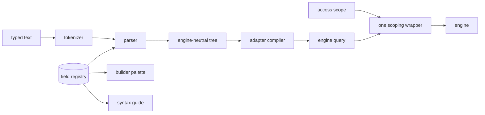

# Search syntax

## Problem

Search engines interpret punctuation, proximity, and analysis differently. Sending a person's text directly to an engine changes meaning during an adapter swap and can turn a typo into a different search. A field list copied into the compiler, the builder, and the help page drifts, so the help promises fields the compiler refuses.

## Use when / Do not use when

Use when precise search meaning must survive engine changes for the people who review documents. Do not use when a relevance-only box supplies all required behavior.

## Environment

One parser, one field registry, an engine capability registry, structured content with positional boundaries, and licensed word-form resources.

## Solution

The search syntax expresses terms, phrases, Boolean combinations, exclusions, expansion, proximity, content zones, metadata fields, ranges, value lists, regular expressions, fuzzy matching, tag scopes, and topics. A tokenizer classifies each lexeme; a parser builds one engine-neutral tree; adapters compile that tree rather than reading the original text.

**Precedence, loosest to tightest:** `OR`, then `AND`, then `NOT`, then proximity and `BUT NOT`, then a primary (term, phrase, group, field, range, list, regular expression, topic). Parentheses override precedence. `NOT` excludes whole documents; `BUT NOT` excludes only matches of its left side that occur with its right side. A proximity chain groups from the left: `a /5 b /3 c` is `(a /5 b) /3 c`.

**Adjacency.** A query of bare content words and nothing else is ranked free text: every word scores, and a document matches when at least one does. Once any operator appears, two content words side by side are refused at the second word's position, with a message asking for `AND` or `OR`, because `a b AND c` has no meaning a person can predict. A field restriction, range, list or flag beside anything joins it with `AND`.

**Writing.** Word operators (`AND`, `OR`, `NOT`, `NEAR`, `PRE`, `BUT NOT`, `MATCHES`, `IN`, `TO`, `REGEX`, `TOPIC`) are operators only in capitals; in lower case they are words. Slash operators (`/5`, `w/5`, `/s`, `w/p`) are operators in either case. A parenthesis directly after a letter or digit, with no space, is part of the term (`83(b)`); after a space, the start of the query or an operator, it opens a group. A tag name with spaces is quoted (`tags:"follow up"`).

**The constructs:**

| Form | Meaning |
|---|---|
| `merger acquisition` | Ranked free text, only when the whole query is bare words: each word scores and one must match |
| `merger AND termination`, `merger & termination` | Exact Boolean: every content term required |
| `lease OR rental` | Either |
| `contract NOT draft`, `contract % draft` | Documents with the first and without the second |
| `"material adverse change"`, `"83(b)"` | Literal phrase; operators and punctuation inside quotes are text |
| `indemn*`, `organi?ation` | Wildcards, never stemmed |
| `run!` | Root expansion from the licensed word-form list; a word not in the list is refused |
| `notice /5 termination`, `notice w/5 termination`, `notice NEAR/5 termination` | Within 5 words, either order; bare `NEAR` means within 8 |
| `force PRE/3 majeure` | Within 3 words, in this order |
| `indemnify /s negligence`, `warranty w/p disclaimer` | Same sentence, same paragraph, either order |
| `breach /s default BUT NOT cured` | Matches of the left side that do not occur with the right side |
| `footnote:"safe harbor"`, `header:indemn*` | Content zone restriction |
| `from:counsel`, `subject:(renewal OR extension)` | Metadata field; the restriction binds to the next primary |
| `subject~:recieve` | Fuzzy match on that field |
| `modified:[2025-01-01 TO 2025-06-30]`, `size:>10mb`, `created:>=2024-01-01` | Closed or open range, on date and number fields only; `>=` and `<=` include the bound. Dates are read in the tenant's time zone, shown in the readout, and a date-only upper bound includes its whole day. Sizes are binary: `kb` is 1,024 bytes, `mb` 1,048,576 |
| `from: IN(counsel, partner, "outside counsel")` | Any value in the list |
| `type:email has:attachments`, `is:unread` | Kind and flag filters |
| `tags:privileged`, `tags:"follow up"`, `volume.tag:closing`, `library.tag:closing` | Item tags, or items in containers carrying a tag; a name matches every same-named tag in libraries the person can read, and a name with none is refused |
| `subject MATCHES /INV-[0-9]+/`, `REGEX("[0-9]{3}-[0-9]{4}")` | Regular expression on a field, or on the body, matched against whole terms |
| `TOPIC("water supply")` | Semantic topic over content sent for embedding |

**One field registry** defines every searchable field once. Its mechanical half is read from the index mapping: each field's type picks its operator class (match, term, range, Boolean) and the exact, stemmed, and prefix variants it has. Its curated half names the logical fields people type, their aliases, fields that fan out to several stored fields (an importance filter covering email and calendar items), virtual flags (`is:`, `has:`), display labels, and fields that are never searchable. The parser, the compiler, the visual builder's palette, and the syntax guide all read the registry; nothing else lists fields.

**The syntax guide** shown to people is generated from the registry. Every example in it is parsed and compiled when the guide is built, so an example that stops compiling fails the build instead of reaching a person.

**Compiling.** Content zones match their exact and stemmed variants together, with the exact match scored higher. Field restrictions, ranges, lists, flags, tags, and regular expressions are non-scoring filters. The compiler emits only a fixed set of engine query types and never a script. It never adds tenant or access scope; one wrapper adds it to every query.

## Ports

- SyntaxParser validates searches and produces the engine-neutral tree, or refuses with a position and a reason.
- SyntaxGrammar describes the supported language for a selected engine.
- FieldRegistry lists every searchable field with its operator class, variants, aliases, fan-outs, and label.
- SyntaxGuide renders the registry and its compile-tested examples for people.
- EngineRegistry declares supported constructs, content zones, and work limits.
- WordFormList supplies licensed tense and number expansions.
- Adapter compiles supported meaning without weakening it.

## Rules

1. **Share one parser across typed search, the builder, and translation,** because separate parsers drift. A browser check before sending calls that parser; it never carries a copy of the grammar or the field list. Refuse malformed input with its position and a useful explanation rather than guessing, and carry the position through to the message a person sees.
2. **Define phrase analysis, escaping, precedence, aliases, and punctuation once,** because an example cannot have two valid interpretations. Quotes are the one literal marker: operators and punctuation inside quotes are text, two quote marks in a row inside a phrase stand for one quote mark (`"the ""best"" offer"`), and there is no backslash escape; and keep the punctuation that distinguishes amounts, section references, and hyphenated terms. A section symbol and its following number are one expression even when separated by a space.
3. **Treat adjacency as ranked free text only in a query of bare words, with one word required, and refuse bare adjacency once any operator appears,** because requiring every typed word returns nothing when one word is rare, a tunable floor makes one query return different sets on different deployments, and adjacency mixed with operators has no predictable meaning. A written `AND` is exact.
4. **Keep separate linguistic and literal representations,** because ordinary analysis can discard punctuation or stem exact language. [Multiple representations](https://docs.opensearch.org/latest/mappings/mapping-parameters/fields/), [custom analysis](https://learn.microsoft.com/en-us/azure/search/index-add-custom-analyzers). How punctuation is kept searchable is index-search-literal.
5. **Limit root expansion to documented tense and number forms from a licensed, versioned list,** because uncontrolled expansion changes legal meaning and unverified licensing prevents redistribution. Wildcards, fuzzy matches, and regular expressions are never stemmed.
6. **Make every field, zone, and range an entry in the field registry, and refuse anything else,** because a restriction treated as ordinary text silently widens a search. Refuse access fields such as the tenant outright. Accept a range only on a date or number field, so a subject that starts with a bracket stays text.
7. **Compile to a fixed set of engine query types, never a script, and add access scope in one wrapper,** because a compiler that can emit scripts is an injection path, and scoping in more than one place leaves one place unscoped.
8. **Match regular expressions against complete literal terms and bound their expansion,** because engine expressions operate on indexed terms rather than arbitrary substrings and can consume excessive resources. [Term matching](https://docs.opensearch.org/latest/query-dsl/term/regexp/), [engine semantics](https://learn.microsoft.com/en-us/azure/search/query-lucene-syntax).
9. **Use native proximity only when its meaning agrees with the syntax,** because ordering and distance behave differently across engines. Proximity operands are terms, phrases, or groups of terms. [Ordered proximity](https://docs.opensearch.org/latest/query-dsl/span/span-near/), [unordered proximity](https://learn.microsoft.com/en-us/azure/search/query-lucene-syntax).
10. **For sentence, paragraph, and `BUT NOT` checks above the engine, retrieve a genuine candidate superset before testing exact boundaries,** because a word-distance approximation or a ranked cutoff discards valid matches. Refuse work beyond the bound; never label partial matches exact.
11. **Restrict topics to content sent for embedding and disclose that coverage,** because semantic retrieval cannot search unembedded material. Grammar omits unavailable capabilities, and execution rejects them too.
12. **Build the syntax guide from the registry and compile every example in it,** because a hand-written guide promises fields and forms the compiler refuses.
13. **Store a saved search as its parsed tree, with tags held by id, and show it with current names,** because saved text holds a tag's old name, which can later name a different tag.
14. **Require shared parse expectations and a redistributable corpus with expected hits across adapters,** because equal parse trees alone do not establish equal results. Each adapter inherits the shared cases and adds its own boundary cases.

## Conformance

1. Given each example in the [parse examples](conformance/syntax-examples.json), the parser produces its tree; given each malformed query, it refuses at the listed position.
2. Given `NOT a /5 b`, the tree excludes documents where `a` is within 5 words of `b`, because proximity binds tighter than `NOT`.
3. Given `merger acquisition` and `merger AND acquisition`, the first returns documents with either word ranked by both, and the second only documents with both; given `merger acquisition AND termination`, the parser refuses at `acquisition`.
4. Given an exact phrase or punctuation-bearing expression, linguistic variants do not substitute.
5. Given an unknown field or a tenant field, the parser refuses with its position; given `subject:[EXTERNAL]`, the brackets are text.
6. Given every syntax-guide example, each compiles; removing a field from the registry fails the guide build.
7. Given terms in adjacent sentences or a long shared paragraph, boundary behavior agrees across engines without losing distant valid candidates.
8. Given unavailable capabilities or exceeded precision bounds, execution refuses without silently weakening the query.
9. Given a compiled query, it contains no script and no access scope; the wrapper's output contains the scope.
10. Given each out-of-scope query in the parse examples, the parser refuses it with its listed reason.
11. Given `modified:[2025-01-01 TO 2025-01-31]`, an item modified at 11 p.m. on January 31 in the tenant's time zone matches.
12. Given a saved search on a tag that is then renamed, the saved search still finds the tagged items and shows the new name; typing the old name finds nothing.

## Swap points

Replace compilers, word-form resources and work limits while preserving the syntax's meaning, one parser, one registry, and the shared conformance.

## Sources

The engine pages linked in Rules document analysis, proximity, and expression traps. The [parse examples](conformance/syntax-examples.json) supply examples, not authority over these rules.

## Known gaps

Sentence and paragraph proximity and passage-level `BUT NOT` need a boundary-aware candidate check that is designed, not run. Word-form resources require redistribution permission. Proven: the parser against the parse examples and the compile-tested guide. Designed, not run: the adjacency refusal, saved searches held as trees, and time-zone date bounds.
