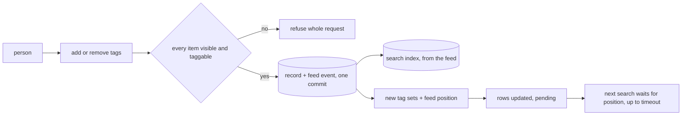

# Tags

## Problem

Reviewers sort documents into piles: hot, privileged, follow up. Free-typed tags split one pile into "Hot", "hot " and "HOT". A rename that rewrites every item is slow and leaves half-renamed piles. A tag write that skips the access check lets a person tag, and so learn about, an item they cannot open. And a screen that searches right after tagging shows the old results, so the tag looks lost.

## Use when / Do not use when

Use when people label items to group, find, review or export them. Do not use for labels a machine assigns with a score (classification), which carry their own confidence and source.

## Environment

A record store holds tag definitions and item tags; the search index carries each item's tag ids for filtering. Every call runs as a signed-in person whose access index-access resolves.

## Solution

Two levels:

- **Item tags** are labels on one item. Each item holds a set of tag ids.
- **Tag definitions** are kept per library: a stable id, a display name, a normalized name, a color and a description. An item tag always points at a definition, so a rename changes one row and every item shows the new name.

Libraries and volumes can carry tags too, set by people who may tag that container.

Names are normalized on the server: trimmed, inner spaces collapsed, compared case-insensitively, at most 40 characters, no control characters. Two definitions in one library cannot share a normalized name. Typing a name that exists picks that definition; a new name creates one, if the person may.

**Writes.** Add or remove tags on the checked rows, or on the clicked row when none are checked. Tagging is its own permission (index-access): seeing an item does not grant it. The server resolves the items through index-access and refuses the whole request if any item is not visible or not taggable by this person. It commits the tag change with its feed event in one transaction (index-content), and the engines update from the feed. The response returns each item's new tag set and a write version: the change's feed position.

**Read your writes.** The screen applies the returned tag sets to its rows at once and marks them pending. The next search carries the write version, and the service waits for the engine to pass that feed position, up to a timeout (default 2 seconds); past it, the answer is returned flagged as catching up. A fixed delay is never used.

**Lists.** The tag panel lists definitions with a count of items the person can see, never a tenant-wide count. Choosing one opens the items with that tag; several chosen match any of them.

**Search.** `tags:hot` filters without changing scores; a name with spaces is quoted (`tags:"follow up"`). A name matches every same-named definition in the libraries the person can read; a name with none is refused, with its position. `library.tag:` and `volume.tag:` select containers by their tags and are resolved on the server to containers the person may read, then applied as a scope. A saved search keeps its parsed tree with tag ids and shows current names (index-query-syntax), so a rename does not break it, and a later tag that reuses the old name is not matched by it.

**Export.** A tag can start a markdown export (index-markdown): the items with that tag that the person can read, resolved when the job starts and then frozen.

**Manage.** Library managers create, rename, recolor, describe and delete definitions. The server checks the manager role on every call. Delete first marks the definition deleted, so it disappears from lists, search and new writes at once; then its item tags are removed in batches that can resume, the items are re-indexed, and the definition is purged.

## Ports

- TagStore.apply(items, add, remove): each item's tag set and a write version. Errors: an item not visible or not taggable, an unknown or deleted tag, a name over the limit.
- TagStore.applyToContainer(container, add, remove): the container's tag set and a write version. Errors: the same.
- TagStore.list(scope): definitions with visible counts. TagStore.items(tags, page): the visible items with any of them.
- TagDefinitions.create, rename, update, delete: manager only; delete reports progress.
- SearchIndex.wait(version, timeout): returns once the engine has passed that feed position, or at the timeout with a catching-up flag.

## Rules

1. **Normalize names and enforce limits on the server,** because a limit kept only in the browser is skipped by any other client, and case or space variants split one pile into many.
2. **Point item tags at a definition id, and show the definition's name,** because rewriting every item for a rename is slow and leaves a half-renamed state when it stops.
3. **Check visibility and the tag permission on every item in a tag write and refuse the whole request if one fails,** because a partial write tells the person which items exist, and seeing an item does not mean a person may label it.
4. **Count and list only what the person can see,** because a tenant-wide count reveals items outside their access.
5. **Check the manager role on the server for every definition change,** because a role checked only on screen protects nothing.
6. **Resolve container-tag scopes on the server to containers the person may read,** because a tag scope is a way around access if it resolves to every container that carries the tag.
7. **Return the new tag sets and a write version, and make the next search wait for it up to a timeout,** because a search that runs before the index catches up shows the old results, and a fixed sleep is too short under load and too long otherwise.
8. **Commit each tag change with its feed event, and let the engines follow the feed,** because a write to the record store and then the index is a dual write that a crash between them leaves out of step.
9. **Remove tags of erased items with the item,** because a tag can name a matter or a person.
10. **Mark a deleted definition first, then remove its item tags,** because a delete that runs in batches otherwise leaves a half-deleted tag usable.
11. **Keep saved searches as trees with tag ids,** because saved text holds an old name that a new tag can take.

## Conformance

1. Given "Hot ", "hot" and "HOT" typed in one library, one definition exists and all three pick it.
2. Given a 41-character name sent straight to the service, it is refused.
3. Given a rename, every tagged item shows the new name, a saved search made before it still finds them and shows the new name, typing the old name finds nothing, and no item record was rewritten.
4. Given a write over two items where one is not visible, nothing is written and the answer does not say which item failed.
5. Given a tag on 10 items of which the person can see 3, the list shows 3.
6. Given a tag write followed at once by a search, the search includes the change.
7. Given a non-manager calling rename directly, it is refused.
8. Given `library.tag:x` where one tagged library is not readable, results come only from the readable ones.
9. Given a person who can see an item but lacks the tag permission, a tag write on it is refused.
10. Given a delete interrupted halfway, the tag is already absent from lists, search and new writes, and the delete resumes.
11. Given a search held past the timeout, it answers flagged as catching up.

## Swap points

Replace the record store, the index and the screen controls, while keeping server-side normalization, definition ids, per-item access checks, visible-only counts and read-your-writes.

## Sources

- [Index refresh and read visibility](https://docs.opensearch.org/latest/api-reference/document-apis/index-document/); engines differ in whether a write can wait to become visible, so the wait is on the feed position.

## Known gaps

Proven: item tags, normalized names, add and remove on a selection, tag lists and files by tag, `tags:` and container-tag search, tag-based export. Designed, not run: definition ids for rename, the tag permission, container tag writes, visible-only counts, read-your-writes on the feed position, and tombstoned delete.
