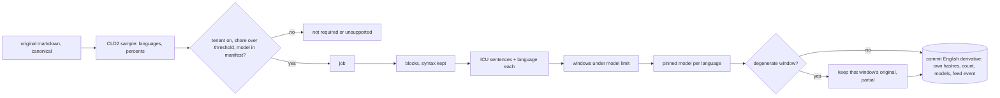

# Translation

## Problem

A reviewer searching in English misses every document written in Spanish, Japanese or German, and cannot read the ones they find. A translation that replaces the original destroys the evidence: original-language terms become unsearchable, comment anchors and page positions point into a text that no longer exists, and nobody can check the machine's work. A machine translation that silently loops one phrase, or cuts a long passage off, puts garbage beside good text. A model fetched from its hub at run time can change under you, fail when the hub is down, and tell the hub what you run.

## Use when / Do not use when

Use when a collection holds documents in languages its reviewers do not read. Do not use when every reviewer reads every language in the collection, or when no machine translation may be shown beside a document.

## Environment

Language detection runs in the extraction worker. Translation runs as its own job on a model host: CPU is enough for small models with int8 inference, and a GPU host that can scale to zero suits large ones. Models are files pinned at build time and loaded from a read-only path; the model runtime has no network access.

## Solution

**Two markdowns, never one overwritten.** The original markdown is canonical: it alone owns the content hash (index-content), drives re-extraction and anchors, and is the evidence. The English translation is a derivative stored beside it, with its own hashes (SHA-256 and BLAKE3) and its own token count, keyed by the original's content hash, the sentence splitter's version and the revision of each model used. Both texts keep the same block ids, and a block left as is stays byte-identical, so a view can switch between them in place.

**Detect, while extracting.** After the markdown is made and hashed (index-markdown), detect its languages with CLD2, for example through the `cld` binding. Sample up to 256 KB spread across the whole markdown, not only its start. CLD2 reports at most three languages per text and is no longer maintained; record its reliability flag and treat a low-share result as a hint. Drop the unknown result and any language under 10% of the text. Store each language with its code, percent and score, and index the codes so a person can filter by language.

**Decide.** Queue translation only when the tenant has it on, the markdown was made, the non-English share is at or above the tenant's threshold (default 20%), and the model manifest holds a model for at least one detected language. Record the decision (pending, not required, or unsupported) in the same commit as the item, so a stopped worker strands nothing.

**Translate, as its own job:**

1. Split the markdown into blocks, leaving its syntax untouched: zone headings, heading marks, list markers, table pipes, code fences and their contents, footnote marks, and the field labels of an email or event.
2. Split each block into sentences with ICU's sentence break iterator, using the block's dominant detected language as its locale. [pySBD](https://github.com/nipunsadvilkar/pySBD) is an alternative for the languages it covers. Whichever splitter is used must cover every language in the model manifest.
3. Identify each sentence's language, limited to English plus the manifest's languages, because a short sentence is misread when every language is allowed. A sentence that none of them fits with confidence is marked unsupported, so it is never forced onto a wrong model.
4. Group neighboring sentences of one language in order, and pack each group into windows under the model's input limit (512 tokens for OPUS-MT), counted with that model's own tokenizer. Order the job's windows by language, so each model loads once.
5. Translate each non-English window with that language's model; English passes through. A sentence longer than the limit is split at the limit and the item marked partial. A sentence in a language with no model passes through untranslated and the item is marked partial, with the count of segments translated out of the total. Never pivot silently through a multilingual fallback model.
6. Reject a degenerate window: at least 50 words and over three times the source's word count, or at least 40 words with one bigram over 30% of them. A rejected window keeps its original text and marks the item partial.
7. Put the blocks back in order.

**Commit.** The job commits the translation, its hashes and count, the status (translated, partial, failed, not required, unsupported), the languages translated from, and each model's id and revision, with its feed event, in one conditional write made only while the original's content hash is still current. A new model revision writes a new derivative and a feed event; the original is untouched.

**Search, preview, export, erase.** The engines index the original with a per-language analyzer (CJK needs its own) and the translation in a separate English field; a query searches both, and each hit says which text matched. Preview and the Markdown tab offer both texts with the model and its license named, as search-preview sets. An export lets the person choose original, English or both, and labels translated text with its model. Erasing the item erases both (index-content).

**Choosing models.** Models are examples, not locks.

- **OPUS-MT, the default.** One small Marian model per language pair, loaded on demand after detection. Each language has several candidates: a pair model, a larger `tc-big` model for some languages, and group models covering several source languages. Quality varies widely between them, and weak languages (Japanese, Korean, Chinese among them) often have a better larger model. Choose each language's model deliberately, record it in the manifest, and measure it. Licenses differ by model card (CC-BY-4.0 or Apache-2.0), so the manifest records each one's.
- **MADLAD-400, an option this pattern has not tested.** One Apache-2.0 model covering over 400 languages, with quality its card says varies by language. It runs on CPU, but at its size a GPU is the practical host: the smallest, 3B, is about 11.8 GB of weights, so load time, memory and a cold start on a scale-to-zero GPU host all count. Host it on demand as a fallback for languages OPUS-MT covers poorly.
- **Ruled out: NLLB-200,** because its license is non-commercial and its card says it is not for production, legal-domain or document translation.
- **Evaluate before choosing:** run every candidate on the same sample of your own documents per language; score with BLEU and chrF and a human spot check; record load time, memory, and cost per million tokens.

**Download once, use many, offline.** At build time, the only step with internet: download each model at a pinned full commit revision, only the files it needs (configuration, tokenizer, one weights file), and delete the download cache. Optionally convert to CTranslate2 with int8 quantization. Write a manifest holding each model's repo, revision, license and each file's SHA-256 and BLAKE3, copy it all to a private bucket under a path fixed by the revision, then bake it into the image or mount it read-only. At run time, set the hub's offline and telemetry-off variables before any import, because they are read at import; load by local path with local files only; verify every checksum against the manifest and refuse on mismatch. Cache loaded models least recently used, keyed by pair and revision and capped by bytes (default half the instance memory), never evicting a model mid-batch; load a tenant's expected languages at start.

## Ports

- LanguageDetector.detect(markdown): languages with code, percent and score, and a reliability flag.
- Translator.translate(markdown, languages): translation, status, the source languages translated, segments translated out of the total, and each model's id, revision and license. Errors: a model missing from the manifest, a checksum mismatch, a model that does not load; each fails the job as retryable and never downloads.
- ModelHost (required) loads models by local path from the manifest, caches them least recently used, and makes no network call.

## Rules

1. **Never overwrite the original markdown; store the English as a derivative beside it, with its own hashes and count,** because the original is the evidence, owns the content hash and holds the anchors, and a reviewer must be able to check the translation against it.
2. **Detect on a sample spread across the markdown, and store every language with its percent,** because a document is often more than one language and its first pages are often boilerplate.
3. **Gate translation on the tenant's setting, the non-English share and the manifest, and commit the decision with the item,** because translating everything spends compute on English, and a decision made outside the commit can strand an item as pending.
4. **Translate block by block and leave the markdown's syntax untouched,** because a model that sees a zone heading, a table pipe or a footnote mark rewrites it.
5. **Use a sentence splitter that covers every language in the manifest,** because a splitter that falls back to one rule set cuts Japanese or Arabic sentences wrongly, and the windows then cut meaning.
6. **Route each sentence to its own language's model, and mark untranslated segments partial,** because one document mixes languages, and a silent pivot or pass-through reads as a full translation.
7. **Pack windows under the model's limit, and reject degenerate windows while keeping their original text,** because a model past its limit truncates, and a looping window puts garbage beside good text.
8. **Choose each language's model deliberately, record it with its revision and license in the manifest, and measure it on your own documents,** because variants of one language pair differ widely in quality, and a default id taken blindly can be the weakest.
9. **Show attribution for every model wherever its output is shown or exported,** because the model licenses require it.
10. **Download once and use many times: pin each model at build time and load it only by local path with verified checksums,** because a model fetched at run time can change under you, re-download on every cold start, and fail when the hub is down.
11. **Let the model runtime make no call to any model provider, ever, for downloads, updates, telemetry or checks: deny its egress at the network, set offline variables before import, and make a load by hub id fail,** because any callback leaks what you run and from where, and a library default can turn one on.
12. **Index both texts, say which one a hit matched, and erase both together,** because original-language terms must stay searchable, and an English copy left behind keeps text its owner erased.

## Conformance

1. Given a document 70% Spanish and 30% English and a 20% threshold, both languages are stored with their percents and the item is queued.
2. Given a document 95% English, it is marked not required and no job runs; given one in a language with no model, it is marked unsupported.
3. Given markdown with zone headings, a table and footnote marks, the translation keeps every heading, pipe and footnote mark in place, with the same block ids.
4. Given a paragraph mixing Spanish and French, each sentence is translated by its own model, in order.
5. Given a sentence over the model's limit, or a sentence in a language with no model, the item is marked partial with segment counts.
6. Given a window that loops one phrase, that window keeps its original text and the item is marked partial.
7. Given a finished translation, the original markdown and its content hash are unchanged; the translation has its own hashes and count; a search for an original-language word and one for its English rendering both find the item, each hit naming its text.
8. Given a model file whose checksum differs from the manifest, the job fails retryable and nothing is downloaded.
9. Given the conformance suite run with the network disabled, every case passes; given a load by hub id, it fails.
10. Given a second job at the same content hash and model revisions, it commits nothing; given a new model revision, a new derivative is committed and the original is untouched.
11. Given an erased item, neither text can be found, opened or exported.

## Swap points

Replace the detector, the splitter, the per-sentence identifier, the models and the host, while keeping the original canonical, the translation as a keyed derivative, syntax kept, per-sentence routing, windows under the limit, the degenerate check, pinned offline models, and attribution.

## Sources

- [CLD2](https://github.com/CLD2Owners/cld2), Apache-2.0; [cld binding](https://github.com/dachev/node-cld).
- [OPUS-MT](https://github.com/Helsinki-NLP/Opus-MT), models CC-BY-4.0, with its citation request; an example model card with its own license: [opus-mt-es-en](https://huggingface.co/Helsinki-NLP/opus-mt-es-en); [MarianMT in Transformers](https://huggingface.co/docs/transformers/model_doc/marian).
- [MADLAD-400 3B](https://huggingface.co/google/madlad400-3b-mt), Apache-2.0; [NLLB-200 card, out-of-scope uses](https://huggingface.co/facebook/nllb-200-distilled-600M).
- [ICU sentence boundaries](https://unicode-org.github.io/icu/userguide/boundaryanalysis/); [pySBD](https://github.com/nipunsadvilkar/pySBD), MIT.
- [Hub downloads and file patterns](https://huggingface.co/docs/huggingface_hub/guides/download); [hub environment variables, read at import](https://huggingface.co/docs/huggingface_hub/package_reference/environment_variables); [Transformers offline mode](https://huggingface.co/docs/transformers/installation).
- [CTranslate2 conversion](https://opennmt.net/CTranslate2/guides/transformers.html) and [quantization](https://opennmt.net/CTranslate2/quantization.html).

## Known gaps

Designed, not run: the stored translation beside the original, search across both texts, ICU splitting, per-window rejection, the model cache and the network-disabled conformance run. Proven: CLD2 detection on the markdown, OPUS-MT per sentence with windows under 512 tokens, and models loaded by local path. MADLAD-400 is untested by this pattern. Translation targets English only.
