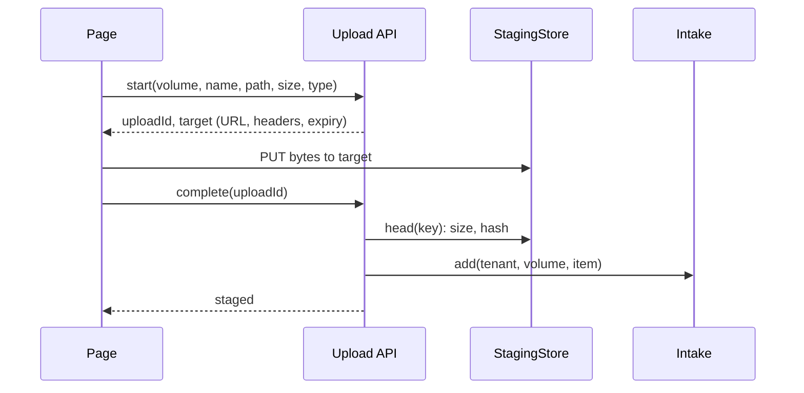

# Upload

## Problem

A person has files on a laptop and wants them searchable. The page that takes them looks simple, but each part
has a common way to fail: a button that sent nothing, browser PUTs blocked by CORS, a signature broken by one extra
header, a size the server checked but storage did not, a path whose shape was taken as proof of who owned it, and an
upload the server never learns has finished, so no batch ever completes.

## Use when / Do not use when

- **Use when** a person drops or picks files in a browser and they must reach content extraction (`index-intake`,
  then `index-extract-tika`).
- **Do not use when** files arrive from a SaaS source (`connector`) or a folder or bucket listing (`index-intake`).

## Solution

Four parts: the page, the upload calls, the staging store, and the hand-off. Upload ends when a file is **staged**:
its bytes are in the store, checked against what was declared, and one intake job is queued. Upload never parses,
unpacks or extracts.

**The page.**

- One drop zone that also opens the file picker, plus a folder picker. Each file keeps its relative path: from a
  folder drop, or `webkitRelativePath` from the picker.
- The list shows each file's name, path and size, with a remove button. A file with the same path and size as one
  already listed is not added twice.
- Before upload, every file is checked against the size cap and the type allow-list. A refused file is shown with
  its reason and is not sent.
- Up to three files upload at once. Each row shows its progress, using `XMLHttpRequest`'s `upload.onprogress`;
  `fetch` reports no upload progress.
- Rows show pending, uploading, staged or failed. A failed row has Retry and shows a plain message for its error
  code, never the raw error.
- Cancel aborts every open request. While work is open, the page warns before it is closed (`beforeunload`), and an abandoned upload expires (rule 11). When everything is staged, it
  says "processing has started".

**The calls.**

- `start` checks the volume belongs to the caller's tenant and checks the name, size and type. It writes a ledger
  row `initiated`, then returns a target: where to PUT, which headers to send exactly, and when it expires.
- `complete` reads the stored object and compares its size to the declared size. It records the bytes hash, marks
  the row `staged`, and calls `Intake.add`.
- `finish(volume)` closes a batch: the volume is done when every row is `staged` or `failed`.
- Retry calls `start` again for a fresh target; it never reuses an expired one.

**The staging store, local first.** One port, two adapters.

| | Local disk | Azure Blob |
|---|---|---|
| Target | the API's own `PUT /uploads/{uploadId}` | a user delegation SAS on one blob, Create (`c`) only, minutes long |
| Size enforced by | counting bytes while streaming; stop past the declared size | `complete` heads the blob; a size mismatch is refused and the blob deleted |
| Written as | `{key}.part`, then renamed to `{key}` once the whole body arrived | Put Blob, or Put Block then Put Block List |
| CORS | same origin as the page | the Blob service's CORS rules list the page's origin, `PUT` and the headers sent |
| Arrival | `complete` | `complete`; Event Grid `BlobCreated` filtered to `PutBlob` or `PutBlockList` may back it up |

Keys are `uploads/{tenant}/{volume}/{uploadId}/{name}`. The server writes the tenant and volume; `uploadId` is new
for every attempt; the name is the declared name after the checks below. The relative path and declared name are
stored on the ledger row, not in the key.

**The hand-off.** `Intake.add` gets the tenant, volume, folder path, declared name, size, bytes hash and storage
key. `index-intake` does the rest: guard, triage, extraction with Tika, then the index. The ledger row moves
`initiated → staged → extracting → indexed | failed`, and the page reads these states.

## Pieces

Everything a first build needs to drop a file, stage it locally and extract its content with
`index-extract-tika`. The names are the same in every language.

| Piece | Kind | Does |
|---|---|---|
| `UploadPage` | page | holds the volume, the file list and the batch state; one per route |
| `DropZone` | component | drop or click to pick files; a second button picks a folder; reports refused files with reasons |
| `FileList` | component | name, relative path, size, remove; no duplicates by path and size |
| `UploadRow` | component | one file's state, progress, Retry, and the plain message for its error code |
| `UploadStatus` | component | counts per state and Cancel; says "processing has started" when all are staged |
| `useUploads` | state | the queue (3 at once), each file's state, abort, retry with a fresh `start` |
| `POST /uploads` | server | `start` |
| `PUT /uploads/{uploadId}` | server | streams the body to `{key}.part`, counting bytes; renames on the last byte |
| `POST /uploads/{uploadId}/complete` | server | `complete`: size and hash checked, row `staged`, one job queued |
| `GET /volumes/{volume}/uploads` | server | `status`, read by the page every few seconds |
| `Ledger` | store | one row per attempt; SQLite or a JSON file locally |
| `Staging` | store | `./data/staging/` locally, a volume mounted into the containers |
| `ExtractWorker` | worker | takes a job, calls the Extractor (`index-extract-tika`), writes `./data/extracted/{uploadId}.json`, moves the row |
| `tika` | container | Tika server, pinned by digest, on a network the worker reaches and nothing else |

Locally, two containers: the app, which serves the page, the routes and the worker, and Tika. The worker has no
credentials Tika could reach.

**Next.js and React.** The page and components are client components. Uploads go to route handlers that stream
`request.body` to disk, never to a Server Action, whose request body defaults to a 1 MB limit. `useUploads` sends
with `XMLHttpRequest` for progress.

**Rust.** The same routes as streaming handlers (axum with tokio, writing with `tokio::fs`); the worker calls Tika
over HTTP with a streaming request (reqwest). Serde writes the content JSON. The page stays React; only the server
and worker move. A native Rust extractor can later stand behind the same port, for example PDF with pdfium-render
and docx with zip and quick-xml, keeping Tika's metadata names so the two compare.

## Ports

| Port | Operation | In → Out | Errors |
|---|---|---|---|
| Upload (provided) | `start(tenant, volume, file)` | name, relative path, size, type → `uploadId`, target, expiry | `not_found`, `too_large`, `type_refused`, `name_refused`, `volume_cap` |
| Upload | `complete(uploadId)` | → `staged`, bytes hash | `not_found`, `size_mismatch`, `expired`, `storage_unavailable` |
| Upload | `finish(volume)`; `status(volume)` | → per-file states and counts | `not_found` |
| StagingStore (required) | `target(key, size, origin, expiry)`; `head(key)`; `open(key)` | → PUT target; size and hash; bytes | `storage_unavailable` |
| UploadLedger (required) | `put(row)`; `move(uploadId, from, to)` | one row per attempt, scoped to its tenant | `conflict` |

## Rules

1. **The tenant and volume come from the server,** never the client; `start` checks the volume against the ledger,
   and a key's shape is never taken as proof of ownership.
2. **Names are refused, not rewritten:** over 255 characters, control characters, `/`, `\`, `.` or `..`.
3. **Type is checked twice:** at `start` against the allow-list, and from the bytes by `index-intake`. The declared
   type is never trusted.
4. **Size is enforced where the bytes land,** not only at `start`: while streaming locally, and at `complete` for a
   direct upload, which deletes an oversized object.
5. **Send exactly the headers the target names.** One extra header breaks a signature or a CORS preflight.
6. **The server is told when an upload finishes.** A batch with no `complete` never ends.
7. **A grant writes one new object** for minutes. It never lists, reads or overwrites.
8. **Every attempt is its own key;** the same file uploaded twice is two items until `index-content` matches their
   hashes.
9. **Errors carry a code from the port's list.** The page maps each code to plain words.
10. **Record each new count with an atomic increment,** never read-then-write.
11. **Abandoned uploads expire:** an `initiated` row past its expiry is marked failed, and its partial object is
    deleted.

## Conformance

1. **Given** a dropped folder of 3 files, **then** 3 rows are staged, each with its relative path, and 3 intake
   jobs are queued.
2. **Given** a file over the cap, **then** it is refused on the page and by the server, and nothing is stored.
3. **Given** a body longer than its declared size, **then** the write stops, the row fails `size_mismatch`, and no
   intake job exists.
4. **Given** a volume id from another tenant, **then** `start` answers `not_found`.
5. **Given** the names `../a.pdf`, `a/b.pdf` and a 300-character name, **then** each is refused `name_refused`.
6. **Given** a canceled upload, **then** its row ends failed and no object or `.part` file remains after expiry.
7. **Given** a retry after the target expired, **then** a new `uploadId` is issued and the file stages once.
8. **Given** (Azure) a page origin missing from the CORS rules, **then** the PUT fails, and adding the origin fixes
   it with no code change.
9. **Given** 10 files with 3 at once, **then** no more than 3 PUTs are open, and the batch finishes when the last
   one stages.

## Swap points

- The store: local disk, Azure Blob, S3 (presigned PUT) or Google Cloud Storage (resumable session).
- The page kit, the caps, the allow-list, and the number of uploads at once.
- Must not change: the server owns tenant and volume, `complete` before intake, size enforced where bytes land,
  codes not messages.

## Sources

- Azure Blob storage events, BlobCreated only after commit on PutBlob or PutBlockList:
  https://learn.microsoft.com/en-us/azure/storage/blobs/storage-blob-event-overview
- Create a user delegation SAS (Entra-signed; Create permission): https://learn.microsoft.com/en-us/rest/api/storageservices/create-user-delegation-sas
- CORS for Azure Storage (service-level rules, preflight 403 without a match): https://learn.microsoft.com/en-us/rest/api/storageservices/cross-origin-resource-sharing--cors--support-for-the-azure-storage-services
- XMLHttpRequest upload progress: https://xhr.spec.whatwg.org/#the-upload-attribute

## Known gaps

- The page and a direct PUT have run on S3 (presigned PUT, finalize) and on Google Cloud Storage (resumable
  session). The local and Azure adapters are designed here and not yet run.
- Large files go up in one PUT. Resuming a partial upload is not designed.
- Folder upload has not yet run.
