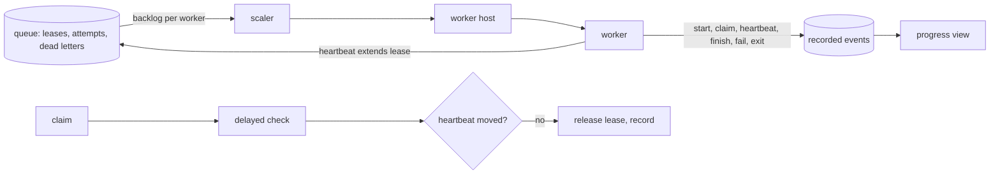

# Indexing workers

## Problem

A pile of files sits waiting while too few workers start, because scale-out is slow, capped, or keyed to CPU that a queue-bound worker never uses. When the work is done, idle workers stay up for hours, because nothing scales in or a keep-alive never ends, and the idle bill grows. A worker that hangs keeps its lease and its file. A worker stopped mid-file loses it. And a worker that does any of this without a record leaves the person watching with nothing to see.

## Use when / Do not use when

- **Use when** indexing work runs on workers that start, claim queued work and exit, on any platform.
- **Do not use when** all work runs inline in one long-lived process with no queue.

## Environment

A durable queue with leases (index-run-control), a host that starts and stops workers, and a scaler that reads the queue's backlog. A managed queue and its autoscaler are examples; the platform supplies the mechanism, and this pattern sets what it must do.

## Solution

**Every lifecycle step is a recorded event.** A worker records its start, each claim, each heartbeat, each finish, each failure and its exit, with its id, the tenant and run of the work, and the time. The progress view (index-progress) is built from these records: a started worker appears, a finished file shows finished, an exited worker leaves. Nothing a worker does goes unrecorded.

**The queue.**

- Delivery is at least once, so every handler is idempotent: a second delivery of a finished job changes nothing (index-run-control).
- The lease (or visibility timeout) is set to the work's expected length and extended by each heartbeat while the worker is alive, so a long file is not redelivered while it runs.
- A permanent failure (invalid input) fails the job at once, with no retry. A transient failure is retried up to a maximum number of attempts (default 5); past it, the job goes to a dead-letter queue and is held there for an explicit recovery decision (platform-errors). The person sees either with its last reason, never as silently gone; an operator can send a held job back.
- Ordering is never assumed: two jobs for one item are reconciled by the item's version at commit.
- Backpressure: a stage that is full stops claiming, and admission slows upstream, rather than piling work in memory.

**Scaling.**

- Scale on backlog per worker (queue depth, or the age of the oldest message), never on CPU, because a worker waiting on a parser or a network call shows little CPU while the queue grows.
- Scale out within a stated time of a backlog appearing (default 60 seconds to the first new worker), up to a stated maximum fleet.
- Scale in to the floor (zero where the platform allows it) after a stated idle window (default 5 minutes with no backlog). An idle worker with nothing to claim for that window exits on its own; a keep-alive always has an end time.
- Each run reserves workers: the smaller of its file count and the maximum fleet, less the floors protected for other kinds of work and the workers already reserved. Inside the fleet, each tenant gets a fair share, so one tenant's large run cannot starve another's small one. The reservation and the running counts change together in one conditional write.
- State the cost of idle: what one idle worker costs per hour, and what the floor costs per day, beside the setting that controls it.

**Stuck work.** An event-driven watchdog costs nothing while idle. Each claim schedules a delayed check (default 2 minutes). If the heartbeat moved, the check schedules itself again; if not, it releases the file's lease so the queue redelivers it, records the release, and counts the lease loss on the file.

**Shutdown.** On a stop signal, a worker stops claiming, then either finishes its current file within the platform's grace period or releases its lease at once, so the file is redelivered. A file is never lost to a shutdown, a scale-in or a crash. An emergency stop is not a shutdown: it cancels the work in progress at once, as big-red-button sets, its commits are refused by the stop fence, and the interrupted files stay held as durable work for recovery after the stop lifts.

## Ports

- **WorkerLifecycle.record(worker, event, work?)**: records start, claim, heartbeat, finish, failure and exit.
- **StuckWatchdog.check(file, claim)** → rescheduled, or lease released.
- **CapacityLedger.reserve(run, files)** → workers reserved; **release(run)**; **share(tenant)** → the tenant's fair share now.
- **Scaler.target(backlog, reservations)** → workers wanted, bounded by floor and maximum.
- **WorkQueue** (index-run-control), **Database**, and **WorkerHost** (required): the host starts and stops workers and sends a stop signal with a grace period.

## Rules

1. **Record every worker start, claim, heartbeat, finish, failure and exit,** because a step not recorded cannot be shown, and the person sees a black hole.
2. **Make every handler idempotent and never assume order,** because delivery is at least once and jobs for one item can arrive out of order.
3. **Match the lease to the work and extend it by heartbeat,** because a lease shorter than the work redelivers a running file, and one much longer leaves a dead worker's file waiting.
4. **Fail permanent work at once; cap attempts on transient work and hold it for a recovery decision; show both to the person,** because endless retries hide a broken file, and a job moved aside silently reads as done.
5. **Scale on backlog per worker, never on CPU,** because queue-bound workers use little CPU while the queue grows.
6. **Scale out within a stated time, up to a stated maximum,** because a pile of files with too few workers waits for hours, and an unbounded fleet runs up cost.
7. **Scale in to the floor after a stated idle window, and let an idle worker exit,** because idle workers left running never expire on their own, and a keep-alive without an end runs forever.
8. **Reserve capacity per run and give each tenant a fair share,** because one large run otherwise starves every other.
9. **Release the lease of a file whose heartbeat stopped, from an event-driven check,** because a hung worker can keep extending its own lease, and a polling sweep costs while idle.
10. **Drain on an ordinary stop signal: stop claiming, then finish or release; on an emergency stop, cancel and keep the work held,** because a worker killed mid-file loses it until its lease expires, and an emergency stop must not wait for a file to finish.
11. **State the cost of idle beside the setting that sets the floor,** because a floor above zero is a standing charge.

## Conformance

1. **Given** a worker started, claiming a file, finishing it and exiting, **then** each step is recorded and the view shows it appear, finish and leave.
2. **Given** a job delivered twice, **then** the second delivery changes nothing.
3. **Given** a file that takes longer than the initial lease, **then** heartbeats extend the lease and it is not redelivered while it runs.
4. **Given** a job with invalid input, **then** it fails at once with no retry; **given** a job failing transiently on every attempt, **then** after the maximum it is dead-lettered and held with its reason.
5. **Given** 10,000 queued files and one worker, **then** a new worker starts within the stated time and the fleet grows to the reservation, never past the maximum.
6. **Given** a finished run and no backlog, **then** after the idle window the fleet is at the floor and the idle workers have exited.
7. **Given** two tenants, one with 100,000 files and one with 10, **then** the small run's files start within its fair share.
8. **Given** a worker that hangs, **then** within the check delay its lease is released and another worker takes the file.
9. **Given** a stop signal mid-file, **then** the worker finishes within the grace period or releases the lease, and the file completes exactly once.
10. **Given** a backlog with low CPU, **then** the scaler still scales out.

## Swap points

The queue, the scaler, the host, the thresholds and the defaults may change. Recorded lifecycle events, idempotent handlers, heartbeat-extended leases, capped attempts with visible dead letters, backlog-based scaling with stated out and in times, an exiting idle worker, per-run reservations with fair share, and drain on stop must stay.

## Sources

- [Kubernetes leases](https://kubernetes.io/docs/concepts/architecture/leases/); [scaling on queue length, one example scaler](https://keda.sh/docs/latest/concepts/scaling-deployments/); [pod termination and grace period](https://kubernetes.io/docs/concepts/workloads/pods/pod-lifecycle/#pod-termination).

## Known gaps

Proven: heartbeats, the event-driven watchdog, per-run capacity reservation and lease-conditioned finishes. Designed, not run: per-tenant fair share, stated scale-out and scale-in times with an exiting idle worker, visible dead letters, and the stated cost of idle. Scale-out time depends on how fast the platform starts a worker.
