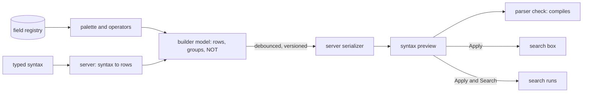

# Visual query builder

## Problem

People who do not know the search syntax still need precise searches: a date range on sent mail, a footnote phrase, attachments over a size. A builder that writes syntax in the browser drifts from the parser, produces queries the server refuses, and cannot load a query someone typed. A builder with its own field list offers fields that cannot be searched.

## Use when / Do not use when

Use when people build structured searches over fields, zones, ranges, and lists, and need to see the syntax their choices produce. Do not use for a relevance-only box.

## Environment

The field registry and parser from index-query-syntax, a server serializer that turns a builder model into syntax and back, and the search screen it opens from.

## Solution

The builder opens as a wide side panel beside the results. Its parts, in order:

1. **Palette.** Every searchable field, grouped in categories: Topic and pattern, Content zones, File and metadata, Email, Calendar, Structure (containers), Sheet and slide, Logic. Categories come from each field's registry entry (its type, the item kinds it applies to), so a field added to the registry appears without a code change.
2. **Condition rows.** Each row is a field chip, an operator menu, and a value input. The operator menu shows each operator's label beside its syntax token (`is any of` beside `IN()`), from the field's registered operators. The input follows the value kind: a date range picker, a number with the field's units, a single value, a multi-value list, or a choice from the field's options.
3. **NOT and groups.** A NOT toggle on each row marks it excluded. Rows sit in groups joined by All or Any, and groups nest up to 5 levels deep.
4. **Live syntax.** A one-line preview in the panel header shows the syntax the current rows produce. The server's serializer writes it; the browser never assembles syntax. The request is debounced and tied to the model it was made from, so a late answer for an older model is dropped.
5. **Scope and mode.** A summary of what the search covers, and the retrieval modes the parsed query uses (lexical, semantic, regular expression), computed by the server from the syntax and shown read-only. A semantic condition is a row of its own (a topic), so every mode is carried in the syntax that Apply writes to the box.
6. **Actions.** Clear, Cancel, Apply (writes the syntax into the search box without searching), and Apply and Search.

**Loading a query.** Opening the builder on a typed query asks the server to turn the syntax back into rows. When the query cannot be shown as rows (a proximity chain, a regular expression on a computed field), the builder says so in words and offers to edit it as syntax in the box instead.

## Ports

- VisualBuilder edits a builder model and returns syntax, or loads syntax into a model.
- FieldRegistry supplies fields, categories, operators with their tokens, value kinds, units, and options.
- BuilderSerializer turns a model into syntax and syntax into a model, or says why it cannot.
- SyntaxParser validates the serialized syntax.

## Rules

1. **Write syntax only on the server, from the same registry the parser reads,** because a browser serializer drifts from the parser and produces queries the server refuses.
2. **Compile every serialized query before showing it,** because a preview that does not compile promises a search that will fail.
3. **Take the palette, operators, units, and options from the registry,** because a builder with its own field list offers fields the compiler refuses.
4. **Show each operator's syntax token beside its label,** because people learn the syntax by building, and the token is what appears in the box.
5. **Tie each preview to the model version it came from and drop late answers,** because a slow response would otherwise show syntax for rows already changed.
6. **Refuse an unknown join or operator instead of defaulting it,** because a silent All in place of Any changes the result set.
7. **Separate Apply from Apply and Search,** because building a query must have no search side effect until the person asks for one.
8. **Load typed syntax back into rows through the server, and say plainly when it cannot,** because a builder that silently drops what it cannot show loses part of the query.
9. **Keep the builder a panel beside the results, not a page,** because people adjust a condition and check the results without losing either.
10. **Carry every choice in the syntax, with no mode or setting kept only in the panel,** because Apply writes syntax to the box, and a choice the syntax cannot hold is lost there.

## Conformance

1. Given rows for "sent after 2025-01-01, from any of counsel or partner, attachments over 10 MB," the preview shows the server's syntax, it compiles, and Apply and Search returns the same results as typing it.
2. Given a field added to the registry, it appears in its palette category with its operators and units, with no builder change.
3. Given two fast edits, the preview shows the syntax for the second.
4. Given a typed query with a proximity chain, the builder says it cannot show it as rows and leaves the box unchanged.
5. Given Apply, the box holds the syntax and no search has run.
6. Given a nested Any group under an All root with one NOT row, the syntax and the results match that structure.
7. Given syntax loaded into rows and serialized again, the second parse tree equals the first.
8. Given a sixth level of nesting, the builder refuses it and says why.

## Swap points

Replace the panel layout, the category order, and the value inputs while keeping server-side serialization, the shared registry, versioned previews, and the round trip.

## Sources

The search syntax, the field registry, and their conformance are in index-query-syntax.

## Known gaps

Some queries have no row form and stay syntax-only. Proven: the palette from the registry, condition rows, groups with NOT, and Apply. Designed, not run: server-side loading of typed syntax into rows and the round trip. Category assignment depends on each registry entry naming its item kinds.
