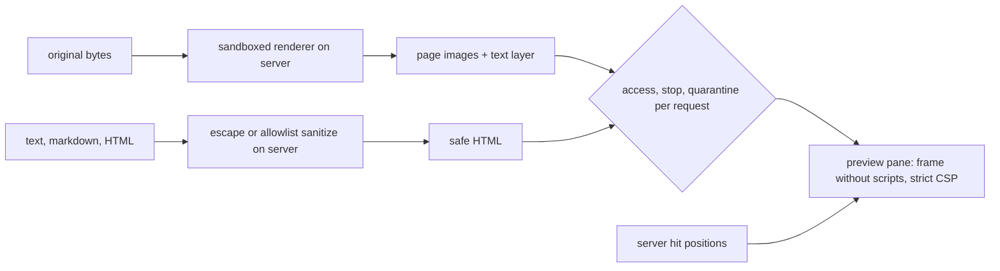

# Search preview

## Problem

A preview pane shows a reviewer documents that anyone could have written. A PDF with script, a spreadsheet with macros, an HTML email with tracking images or a link that runs code reaches the browser and acts as the application, or tells its sender who read it. Rules for this spread across several patterns drift apart until one says a frame may combine script with same-origin access and another forbids it. A pane that finds hits again in the browser marks words the engine never matched. And a translated document shown in place of its original hides what the document really says.

## Use when / Do not use when

Use when people open search results to read them inside the application. Do not use when results only link out to the source system and nothing is drawn in the application.

## Environment

A browser showing what the service sends. The service renders pages with the extractor's sandboxed renderer (index-extract), checks access and stops on every request (index-access), and returns hit positions for the search that ran.

## Solution

This pattern owns every rule for drawing content in the preview pane. Other patterns point here.

**Tabs, for one item.**

- **Preview:** the item drawn for reading. A paged file (PDF, office document, image, scan) is shown as page images rendered on the server, each with a positioned text layer for selection, find and highlights. An item with no pages (an email body, a calendar event, a plain-text or markdown file) is shown as safe rendered text.
- **Native:** the original file offered as a download through the delivery gateway, only to a person who may export originals; it is never opened in the browser.
- **Metadata:** the item's record (index-markdown), as text.
- **Markdown:** the stored markdown, exactly as stored (index-markdown).
- **Comments:** the item's threads.

**What reaches the browser.** Never the original bytes of an active format. Page images and text layers come from the server's sandboxed renderer. Text, markdown and HTML are shown directly, but only after the server makes them safe:

- Plain text is sent as text and shown as text.
- Markdown goes through the escape-first renderer: escape `&`, `<` and `>` first, then emit only a fixed set of tags with fixed classes (headings, bold, italic, code, lists, quotes, tables), with no attribute, link or address taken from the text.
- HTML, an email body among them, is sanitized on the server by an allowlist of tags and attributes; scripts, event handlers, forms, embedded objects, styles that load resources and every remote address are removed.
- Links are shown as text with their address beside them, never as live links. Macros, scripts and embedded active content are never run, at render or in the browser.

**What holds the preview.** A paged file is drawn in the application's own page, not in a frame: each page is an image element, and over it a transparent text layer whose words sit exactly on the words in the image. That layer is what a person selects, finds in and sees highlighted. Plain text is shown by the application as text, never parsed as HTML. Markdown and email bodies, made safe as HTML on the server, are the only content placed in a frame. The original file is never placed in a frame, an embedded object or the browser's own PDF or office viewer, because those run what the file carries and draw their own text, which the index's positions cannot be mapped onto.

**One extraction, one version.** The text that is searched, the text layer that is shown and the positions that are highlighted all come from one extraction of one content version of the item (index-extract, index-content). A preview drawn from anything else, such as a second conversion or the original in a viewer, puts highlights on the wrong words.

**Where the word boxes come from.** For a digital PDF, the PDF library that reads the file is its extractor: one pass gives the text that is indexed and each word's box on the page, so there is one extraction. For a scan, OCR gives both (index-extract-ocr). A document or slide file has pages only once a layout engine draws it, so it is converted to PDF once, the converted PDF is kept as part of that content version, and its text and boxes form the paged view. Wherever the paged view's text comes from a different tool than the indexed text, hits are placed on the pages by matching the parsed query against the paged view's own text, as index-search-literal does where an engine returns no positions.

**Files without pages.** A spreadsheet or CSV is shown as a safe table, sheet by sheet, never converted to pages. An email is shown as its safe body with its header fields, and its attachments open as their own items.

**Pages and text.** The preview has one switch between Pages and Text. Text shows the item's stored text, available at once; Pages shows the drawn pages. Before a page is drawn, Pages shows a loading state for it, never a blank pane.

**The frame.** Rendered text is shown in a frame sandboxed with same-origin access and never with script permission, so the page can place highlights inside it while nothing inside it runs. Every render response carries a content security policy that defaults to nothing allowed, and allows images only from the service itself. No image or other resource is loaded from outside the service.

**Delivery.** Pages, text and markdown come through the service on every request, with current access, stop and quarantine checks (index-access). A 401 renews the session once and retries. An item the person cannot see answers like one that does not exist, and the pane says the preview is unavailable. Size limits come only from trusted service settings, never from the file's own metadata. Pages are rendered on demand and drawn pages cached, scoped to tenant, content version, processing version and page (index-extract). Lockdown stops content already shown and links already issued.

**Highlights.** Every hit is marked from the positions the server returns for the search that ran, mapped onto the text layer or the rendered text, as search-ui rule 8 sets. A position the server cannot supply is reported in words, never guessed.

**Original and translation.** For a translated item (index-translation), the Preview and Markdown tabs toggle between Original and "English (machine translation)". The pane opens on the original, unless the hit matched only the translation, and highlights there. A banner names the model, its revision and its license, which is where attribution is shown. Switching keeps the reader's place, because both texts share block ids.

## Ports

- **PreviewPane.open(item, search)** → the tabs the person may use, the side to open on, and the first hit.
- **PreviewRenderer.page(item, content version, page, language)** → a page image and its text layer. **PreviewRenderer.text(item, content version, representation, language)** → safe HTML. Errors: unavailable (missing, hidden or quarantined), unauthenticated, stopped.
- **Previewer** (index-extract), **ItemResolver** (index-access), **StopGate** (big-red-button), **ContentStore** (index-content), required.
- **HitPositions** (required): for one item and the search that ran, each hit's type and its offsets in the shown text.

## Rules

1. **Render active formats on the server and send only images, a text layer and sanitized text,** because a file opened in the browser runs whatever it carries.
2. **Escape markdown first and emit only fixed tags; sanitize HTML by allowlist on the server,** because one stored document is shown to many people, and markup can carry script, event handlers and script links.
3. **Never give a frame holding document content script permission, and send a content security policy that allows nothing but the service's own images,** because either gap alone lets document markup run as the application.
4. **Show links as text and load no outside resource,** because a remote image or a clicked link tells its host who opened the document and when.
5. **Check access, stops and quarantine on every preview request, renew only on 401, and answer a hidden item as unavailable,** because a cached grant outlives its revocation, and a different answer for hidden items confirms they exist.
6. **Take size limits from trusted settings only,** because a crafted file can claim to be small.
7. **Mark hits from the server's positions for the search that ran,** because hits found again in the browser mark words the engine never matched.
8. **Open on the original unless the hit matched only the translation, and always name the model,** because a reviewer must see what the document says, and the model's license requires attribution.
9. **Keep this the one place preview rules live,** because rules copied into several patterns drift until two of them disagree.

## Conformance

1. **Given** a PDF with embedded script, **when** previewed, **then** only page images and a text layer reach the browser and nothing runs.
2. **Given** markdown or an HTML email holding a script tag, an event handler, a script link and a remote image, **then** the pane shows them as text or not at all, runs nothing and makes no outside request.
3. **Given** a render response, **then** its frame has no script permission and its content security policy allows only the service's own images.
4. **Given** an expired session, **then** one renewal loads the preview; **given** an item the person cannot see, **then** the pane says unavailable, exactly as for a missing item.
5. **Given** lockdown while a preview is open, **then** further pages and issued links serve nothing.
6. **Given** a lexical hit split across two formatting runs, **then** both parts are marked at the server's positions.
7. **Given** a translated item and a hit only in its English text, **then** the pane opens on the English side with the hit marked and a banner naming the model and license; switching to Original keeps the place.
8. **Given** a file whose metadata claims a tiny page count, **then** the render limits from the service's settings still apply.

## Swap points

The renderer, the sanitizer, the frame mechanism and the tab layout may be replaced. Server-side rendering, escape-first text, no scripts in the frame, a strict content security policy, per-request access checks, server positions for highlights and the original shown beside its translation must stay.

## Sources

- [Frame sandbox](https://html.spec.whatwg.org/multipage/iframe-embed-object.html#attr-iframe-sandbox); [content security policy](https://www.w3.org/TR/CSP3/).
- [OWASP cross-site scripting prevention](https://cheatsheetseries.owasp.org/cheatsheets/Cross_Site_Scripting_Prevention_Cheat_Sheet.html).

## Known gaps

Proven: the escape-first markdown renderer shown in a sandboxed frame. Designed, not run: the HTML allowlist sanitizer, links shown as text, the Native tab as a download only, and the original and translation toggle. Page images and text layers depend on the extractor's renderer (index-extract). A sanitizer reduces exposure without proving the renderer correct.
